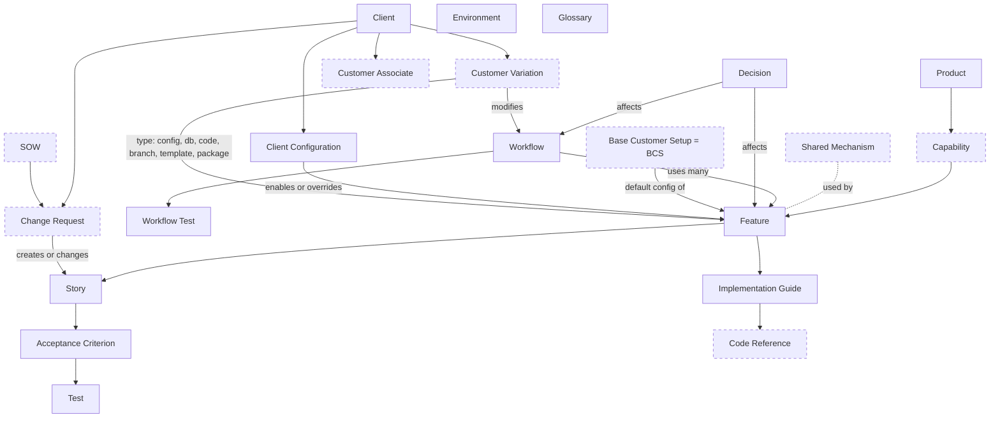

# AIDLC Handoff: Plan, Findings, and Tuesday Meeting Brief

Prepared 2026-10-19 by Obinna Anaenugwu (Technical and AI Lead) with Claude Code. This file moves all planning work so far into the SDS company workspace.

---

## 0. How to use this file (for the receiving Claude session)

- You are picking up a **planning-only** effort. Do not create, edit, or delete files in either repository until Obinna explicitly says the plan is approved and to start implementing.
- Read this file top to bottom first. Then read the companion file `QUICKCLAIM-DISCOVERY.md` (the code discovery report, commit `65a5e86`) if Obinna provides it. You can also regenerate any detail from the QuickClaim repo directly.
- Mentor meetings on 10/20 and 10/27 have happened. **Section 0.6 (10/27) is the newest and wins over everything. Section 0.5 (10/20) wins over the rest.**
- Follow the rules in Section 1.5 at all times.
- **Newer than this file:** the 11/03 meeting outcomes and the current work are in `AIDLC-WEEK-1103-ZINA-SOURISH.md`, which wins over everything here. Implementation was approved on 2026-11-02, so the planning-only note above no longer applies.

---

## 0.6 Mentor meeting outcomes (Tuesday 2026-10-27)

Source: meeting transcript (auto-transcribed, some names garbled, for example "Sentine" means Centene and "Suresh" means Sourish). This is the newest section and wins over everything else in the file.

### What the team presented
- Two consolidated documents: Sprint 2 progress and findings, and proposed changes to the DDPD repo.
- Hierarchy refined with the SDS taxonomy as vocabulary.
- First product vs. workflow review, with a six-step Appeals handoff from Digital Mailroom into workflow queues.
- Current State Assessment with the 15 findings grouped into categories, each with a proposed fix.
- Safe YAML copy rules.
- A consolidated list of questions for sponsor approval.

### Decisions and answers from Zach
1. **CENTENE's customer code is CENCORP.** This replaces the 10/20 note that said CEN.
2. **No major issues with the plan** ("nothing raging"). The team can start implementation this week once repo access is set up.
3. **Templates:** two (feature and story) are not enough. A **change request template** is a good addition. More templates are expected.
4. **IDs:** Zach chose IDs for human readability, because many files look alike in an editor and IDs show where you are. He asked for concrete examples of the current ID problems and our proposed fix.
5. **Environments:** QuickClaim has **local, test, and prod** (three, not two). No QA yet. Some places use different names for these.
6. **No docs folder in QuickClaim** is expected. Applying DDPD to QuickClaim is the point of this project.
7. **Capability vs. taxonomy wording** is considered resolved.
8. **Work in the real GitLab repo, not the zip.** Zach does not want to copy-paste our work. The repo sits in a different group, which caused the access problem. Zach made Aima a full member (guests see an empty repo), is protecting branches, and will add everyone. Clone over SSH (HTTP does not work for him). Editing directly in GitLab is also fine. **Do not push anything until branches are protected.**

### Change requests: Zach's main guidance (high priority)
- A customer change request can become one of three things: something built only for that customer, an enhancement, or a product change. **Track both the change request and what it became.**
- **Why it matters:**
  - Agents and people must know that a story exists because of a contract with a customer, so they do not change or delete it freely.
  - SDS is audited often, and every change needs a recorded reason. A change must link back to the change request that caused it.
- **Where it lives:** a change request document in the client's folder. Stories or features it created carry a **change request ID** that links back to it.
- **Trace chain:** client > change request > feature or story > test cases.
- **Customer termination use case:** if a customer leaves, an agent (even a cheap one) should find everything tied to that customer through the IDs, check whether any other customer uses the same feature or piece, and safely delete what is no longer needed. The goal is to remove code bloat, meaning code nobody touches because nobody knows who uses it.
- **CENTENE example:** CENTENE may not have formal change requests yet, since requests during implementation are documented as part of the implementation. Those still count. Zach's example: CENTENE has documents that must be labeled a certain way because of their own workflow, and no other customer uses that. When it is no longer needed, it should be easy to find and remove.

### What this means for the plan
- **Add to the information model:** a Change Request concept with an outcome type (customer-only, enhancement, product change), a change request ID field on features and stories, a "contractual" marker, and a reverse lookup for "which customers use this feature."
- **Add to traceability validation (Goal 2):** a **customer termination test**. Starting from the CENCORP client folder, an agent must find every change request, feature, story, and test tied only to CENCORP, and correctly skip anything shared with other customers.
- **Environments:** model local, test, and prod. Leave room for QA later.
- **Repo work:** everything goes on a feature branch in the SDS GitLab repo once branches are protected.

### Plan for the coming week (presented by the team)
1. Finish Sprint 2: complete the Current State Assessment and the product lifecycle analysis (map each stage of building and running a product to the documents it needs).
2. Map the CENCORP code in more depth.
3. Get Zach's feedback on the drafts.
4. **Baseline AI test:** measure how accurately AI tools answer QuickClaim questions today, and how long they take to find information. Repeat after new docs exist to show the improvement.
5. Start the Base Customer Setup (BCS) documentation in Sprint 3, after approval of the structure.

### Action items from 10/27
| Owner | Action |
|---|---|
| Team (whoever owns IDs, likely Obinna) | Send Zach examples of the current ID problems and the proposed fix. Follow up within one or two days. |
| Zach | Protect branches and add all team members to the DDPD repo. |
| All | Accept the GitLab invite, clone over SSH, and wait for branch protection before pushing. |
| Obinna, Zina | Add the change request model and the customer termination test to the information and traceability model drafts. |
| Zina | Add a change request template to the template plan. |
| Team | Run the AI baseline test before any new docs are written. |

---

## 0.5 Mentor meeting outcomes (Tuesday 2026-10-20)

Notes taken by Obinna during the meeting with Zach. Some points were brief, so items marked **(interpretation)** should be confirmed with Zach in writing.

### Decisions

1. ~~CENTENE's customer code is CEN, not CENCORP.~~ **Corrected on 10/27: Zach confirmed the CENTENE customer code is CENCORP** (see Section 0.6). This matches the discovery report.
2. **Docs copy customer settings as YAML files.**
   - Customer configuration is copied into YAML in the DDPD repo, not just referenced.
   - Depending on the project's results, SDS may update QuickClaim to read its configuration from the files we create. That would make the docs the source of truth and remove drift.
   - This resolves framework issue 13 (Single Source of Truth) in favor of the current spec.
3. **Appeals is a workflow (Zach leans this way).**
   - Appeals is a workflow that uses two products. (interpretation: most likely Digital Mailroom and Workflow Queues. Confirm the two product names.)
   - Zach also wants us to **review and audit how a product is defined compared to a workflow**, so the line between the two is clear and justified.
4. **Scope: stay focused on CENTENE.** Clearinghouse folders do not need to be reviewed.

### Hierarchy guidance

Zach's view of how Digital Mailroom fits Product > Capability > Feature > Story:

- **Product:** Digital Mailroom.
- **Capability:** a part of the product that a customer can have enabled or disabled. This is how a capability plugs into a workflow. Examples he gave:
  - Fax intake
  - SFTP intake
  - API intake (SDS has a limited amount of this)
  - Mailroom intake (SDS runs a hosted mailroom for clients: it takes mail and emails, scans them, and loads them)
- **Feature:** every capability has **at least one feature that describes it**. Examples under Fax intake:
  - **Dedicated fax lines.** A customer gives a fax number to the people it works with. Anything sent to that line goes into QuickClaim, and items are labeled differently depending on which line they came in on. A person can also be labeled on a fax line. (interpretation)
  - **Reports** (for example fax intake reporting).
- **User story:** specific behaviors under a feature. Example: label incoming items by fax line.
- **Features that repeat across capabilities:** several capabilities have the same kind of feature, for example **automated assignment**, where teams can lock documents and assign them to people. (interpretation: this is a candidate for the shared layer, or a feature that is defined once and reused by several capabilities. Decide in the information model.)

### What this changes in the plan

- **Capability definition is now concrete:** "a part of a product a customer can enable or disable." This lines up with the code: `CUSTOMER_PROCESS` rows switch processes on per customer and gate dashboard links (discovery report section 5.1). The process code list (gap 7 in Section 4.8) is now a high-priority input, since it may give us the capability list directly. (our inference, confirm with Zach)
- **The draft Digital Mailroom tree in Section 5.1 is replaced** by a channel-based one (see the updated table there).
- **Open question:** do processing steps (page identification, document splitting, data entry) also count as capabilities, since customers can enable or disable them too? Zach's examples were all intake channels.
- **YAML config rules needed:** copied settings must never include credentials, keys, hostnames, or any patient or member data. Decide whether copying is done by hand (repository automation is out of scope) and how copies are kept in sync until QuickClaim reads them directly.

### SDS taxonomy spreadsheet (received 2026-10-26)

SDS shared `Taxonomy - Solution - Product - Capability - Service.xlsx`. It has one sheet with six levels, each with a definition, examples, and a one-question test:

| Level | Definition (short) | SDS examples | Test |
|---|---|---|---|
| Solution | Package of products, services, workflows, and expertise that delivers a customer outcome | Prior Authorization Automation, Provider Data Management, Enrollment Management | Would a customer call it a business initiative or outcome? |
| Product Family | Strategic grouping of related products and use cases | **Digital Mailroom**, Document Intelligence, Intelligent Connectivity, Clearinghouse, Intelligent Operations | Does it contain multiple products and use cases? |
| Product | Marketable offering with ownership, pricing, roadmap, support | Intelligent Medical Records, Enrollment (834), Prior Authorization Gateway (278 and 275) | Could SDS give it a roadmap, price, and owner? |
| Capability | Reusable building block that enables one or more products, not sold alone | OCR and Data Extraction, AI Summarization, EDI Translation, FHIR Connectivity, Workflow Routing, Rules Engine, Queue Management, SLA Tracking, Identity and Access Management | Would a customer buy it by itself? If no, it is a capability. |
| Service | Human-delivered work that helps customers implement or operate SDS products | Implementation Services, Managed Claims Processing, Provider Data Cleanup, Workflow Optimization Consulting, Platform Configuration Services | If the software disappeared, would people still do this work? |
| Product Enhancement | Feature or improvement that adds value to an existing product without becoming a new offering | New payer connector, additional EDI transaction, new workflow rule, new dashboard or report, new API endpoint | If removed, would the product still exist? |

**Status: reference only.** The sponsors confirmed they are fine with our structure (Product > Capability > Feature > Story, with the 10/20 capability definition). Do not restructure around this spreadsheet. Use it to keep our wording consistent with SDS vocabulary.

Optional ways to use it (not required):

1. **Service** is a useful label for people-delivered work such as physical mailroom operations (box receipt, prep, scanning, paper storage) and SDS-staffed keying. It can help decide what goes in product docs versus operations notes.
2. **Product Enhancement** is a useful label for customer change requests that improve an existing feature without creating something new.
3. **The test questions** can be borrowed as plain classification rules in the governance guidelines.
4. Note in the final recommendation that the DDPD "capability" (something a customer can enable or disable) is narrower than the SDS taxonomy's "capability" (a reusable building block), so readers do not mix them up.

### New follow-up questions for Zach

1. ~~What is CENCORP?~~ Answered 10/27: CENCORP is CENTENE's code.
2. Which two products does the Appeals workflow use?
3. Are processing steps (identification, splitting, data entry) capabilities too, or only intake channels?
4. Is automated assignment and document locking one shared feature, or a separate feature in each capability?
5. For the YAML copies, which settings matter most for CENTENE: properties files, database settings, or both?

### Action items from the 10/20 meeting (due at the 10/27 meeting)

These match Meeting Minutes 6. Owners were assigned by Obinna when writing the minutes.

| Owner | Action items | Related Sprint 2 task |
|---|---|---|
| Obinna | Redraft the hierarchy using the capability definition. Start the product vs. workflow review. Send Zach the follow-up questions above. Work with Zina on the Current State Assessment and with Sourish on the YAML rules. | 2.3, 2.5, 2.5b, 2.5c |
| Zina | Build the template gap list. Continue the Current State Assessment with Obinna. | 2.3, 2.9 |
| Sourish | Review how Appeals moves from Digital Mailroom into the work queues. Draft rules for copying customer settings into YAML with Obinna (no credentials, no patient data). | 2.2, 2.5c |
| Aima | Follow up with sponsors on open questions. Request sample CENTENE statements of work and change requests with sensitive data removed. Confirm the team has the latest DDPD repo from GitLab. | 2.0, 2.8 |
| All | Finish action items before 10/27. Get written confirmation from Zach on unclear points. Continue the Current State Assessment. | 2.3 |

Next meeting: 10/27/2026 @ 1:30-2 pm. Notetaker: Obinna Anaenugwu.

---

## 1. Project context

### 1.1 What this is
- UT Dallas CS 4485 capstone, Fall 2026. Sponsor is **Smart Data Solutions (SDS)**, a healthcare automation company.
- Project name: **AIDLC: AI-Ready Documentation Retrofit**, also called **Documentation-Driven Product Development (DDPD)**.
- Problem: QuickClaim knowledge lives in code and in a few experts' heads. AI tools cannot be given database access because of PHI. So documentation must become the main way AI tools understand what the system does and why.

### 1.2 Team

| Name | Role |
|---|---|
| Aima Salman | Project Coordinator and Sponsor Liaison |
| Zina Abou Assali | Documentation Standards Lead (templates, governance) |
| Sourish Pasula | Customer Implementation Lead (Base Customer Setup, CENTENE) |
| Obinna Anaenugwu | Technical and AI Lead (information model, traceability, code mapping) |
| Hasya Padarthi | SDS mentor, Business Automation Manager and Project Manager |
| Zach Polfliet | SDS mentor, Senior Manager of Product Development (technical contact) |
| Professor Yi Zhao | Faculty advisor |

### 1.3 Repositories

| Repo | Purpose | Rule |
|---|---|---|
| `documentation-driven-product-development` (DDPD) | The framework we improve and fill in | Changes only on a feature branch, reviewed before merge |
| `smartdatasolutions` (QuickClaim) | Product source code, read to discover features | Read only. Never modify. |

### 1.4 Goals
- **Goal 1:** Complete the DDPD information model (concepts, relationships, locations, fields, templates, traceability, customer model, governance).
- **Goal 2:** Validate it against CENTENE. Define a Base Customer Setup, document CENTENE's differences, prove two-way traceability, test with humans and AI, show a new customer can be added without changing the structure.
- **Goal 3:** Inventory and document standard QuickClaim behavior.
- Stretch (only if time): AI-assisted workflows, drift prevention, MCP strategy, documentation portal.
- Out of scope: production features, production AI integrations, repository automation, production external integrations.

### 1.5 Working rules
- Never put PHI, real patient data, or real customer records in any document or example. Use made-up data.
- Everything is confidential under NDA. Keep it inside SDS-approved systems.
- Mark anything not confirmed as **unverified**. Mentors confirm.
- Markdown, following DDPD templates and naming unless we are proposing a change.
- Explain reasoning and tradeoffs for every structural proposal.
- Plain, simple writing. No em dashes. No semicolons.

### 1.6 Zach's guidance (9/29 demo recap)
- Known gaps: customer-specific change requests are not represented well, and features may be the wrong top level.
- Design the hierarchy so AI tools read less unrelated documentation per task.
- A feature belongs to one product. A workflow connects features and can span products (for example Digital Mailroom feeding Appeals).
- Keep related pieces grouped (document splitting phases 1, 2, 3 are one capability).
- Same feature, different customer usage: document variations next to the product and feature.
- Functionality that fits no product gets flagged for an SDS decision.
- CENTENE focus: **Digital Mailroom** and **Appeals**. CENTENE's appeals differ from the general product.
- Use AI to find code, trace what touches it, and group it into features, stories, and workflows.

### 1.7 Timeline

| Sprint | Dates | Focus |
|---|---|---|
| 1 | 10/06 to 10/19 | Review repos, start Current State Assessment (CSA) |
| 2 | 10/20 to 11/02 | Finish CSA, lifecycle analysis, first drafts of information and traceability models |
| 3 | 11/03 to 11/16 | Templates, customer model, Base Customer Setup, start CENTENE docs |
| 4 | 11/17 to 11/30 | Finish CENTENE, traceability validation, usability tests, QuickClaim inventory |
| 5 | 12/01 to final week | Standard product docs, gap analysis, governance, final presentation at SDS Plano |

---

## 2. Status as of 2026-10-19 (end of Sprint 1)

| Item | Status |
|---|---|
| Read the DDPD framework repo (downloaded copy, 7 files) | Done. Findings in Section 3. |
| Confirm the downloaded copy matches GitLab `main` | **Not done.** The copy was not a git checkout. |
| QuickClaim discovery (structure, Digital Mailroom, Appeals, customer behavior, config, tests) | Done by a read-only Claude pass. Summary in Section 4. |
| Draft plan (exploration, CSA outline, hierarchy, code mapping, info model, tasks, questions, risks) | Done. Section 5 and 6. |
| Mentor review of the plan | Done 10/20. Outcomes in Section 0.5. |
| Implementation | Not started, waiting for approval |

---

## 3. DDPD framework findings (input to the Current State Assessment)

### 3.1 What the repo contains (downloaded copy)
- `documentation-driven-product-development.md` (the framework spec, about 650 lines)
- `roadmap.md` (SOWs, SRE feedback loop ideas, storage, release notes)
- `ddpd-gaps.md` (one open gap, GAP-001)
- `AI-first-product-development.md` (AI tool SOP)
- `templates/feature-STAR.md`, `templates/feature-STAR-story-STAR.md`
- `CLAUDE.md` (empty)
- **No `/docs` tree exists.** The folder structure is only described in the spec. Zach described areas for products, architecture, workflows, features, stories, and tests. Check whether GitLab has more.

### 3.2 Concepts the spec defines
Product Context, Roadmap, Decision (Product, Architecture, Workflow), Feature, Feature Implementation Guide, User Story, Acceptance Criterion, Test Case (story, feature, workflow level), Workflow Context and Workflow Configuration (YAML), Client Context and Client Configuration (YAML), Environment (YAML), Glossary and business terms.

### 3.3 Gaps, redundancies, and inconsistencies found
1. **Only two templates.** None for Implementation Guide, Test Case, Workflow, Client, Decision, Product Context, or Environment.
2. **Story ID format conflicts.** Spec says `STID-<feature>-<story-number>`. Template says `FTID-X-STID-Y`. ACID and Test ID formats repeat the chain in different ways.
3. **Story template is missing spec fields:** functional requirements, dependencies, assumptions, edge cases, user role breakdown. Title has a typo (`User Story;`).
4. **Product Context "Business Problems" section** has a copied bullet from Vision and a cut-off sentence.
5. **Single product only.** `/docs/product` is singular. Features are a flat list with no product field. No epic or capability level, even though Zach's description mentions epics.
6. **Decision IDs can collide.** Each decision subfolder starts at `decision-001.md`.
7. **Workflow-level tests** are defined but have no folder.
8. **Traceability is one-way only.** Stories point to features and features point to workflows. No back-links are required, and template links are placeholders. Two-way traceability is not possible yet.
9. **Thin customer model.** No change requests, no SOWs (mentioned only in the roadmap), no base customer, no variations tied to a feature. Routing rules appear in both workflow config and client config (redundant).
10. **No code reference field anywhere**, not even in the Implementation Guide.
11. **Lifecycle gaps.** BRDs are required by governance but never defined. Release notes and user guides exist only in the roadmap. Nothing covers support or deployment.
12. **Single Source of Truth tension.** The spec wants behavior-driving config as YAML in the docs. QuickClaim keeps that config in properties files and database tables (Section 4). Copying it into docs would drift. **Resolved 10/20:** copy settings into YAML. SDS may later make QuickClaim read those files (Section 0.5).
13. **Environments.** The spec assumes local, test, QA, production. QuickClaim code only knows local and prod.
14. Minor: the AI SOP names specific vendors, which sits against the "AI Agnostic" principle.
15. GAP-001 (no defined place to say "this criterion has no test yet, and why") becomes important because QuickClaim has very few tests.

### 3.4 Still to check
- GitLab `main` vs. the downloaded copy.
- The `aws-ci-spark` project docs referenced in GAP-001 (the only known real use of the framework).

---

## 4. QuickClaim discovery summary

Source: read-only discovery report, commit `65a5e8621e31afd63a6fa90e901ebdcc158fff7e`, branch `master`. Full detail is in `QUICKCLAIM-DISCOVERY.md`.

### 4.1 Codebase shape
- About 54,000 tracked files, about 38,500 Java. Single Gradle module (Ant files also exist, which one CI uses is unverified). Java 8 default.
- Web framework is **Apache Turbine 2.2** with Velocity 1.2 templates (about 1,470 screens). Routes in `quickclaim/WEB-INF/web.xml` plus Turbine config. Pages pull data from about 50 Velocity pull tools and post to about 265 action classes.
- Preact is vendored and served as static ES modules (about 86 files, mostly `*Beta.js` and `*V2.js`). No bundler.
- About 1,020 background jobs extend `SDSJob`. Schedules and enable flags live in the `SDS_HEARTBEAT` table. What launches jobs in production is outside the repo (unverified).
- Data access is Torque 3.0 ORM (about 650 tables in the main schema) plus custom prepared statements. No migrations tool.
- The repo already has a `CLAUDE.md` and `.claude/commands/`, useful for the AI usability tests.

### 4.2 Product areas (inferred, unverified as official boundaries)
Digital Mailroom, Appeals (as workflow queues), Claims data and X12 EDI, Clearinghouse and provider portal, Remittance and EOB, Eligibility and member matching, Provider matching and repricing, Intake (may be its own product), Medical records and bill review, Correspondence and letters, Billing and internal ops, Reporting and BI, Member portal. `J/clients/` holds 576 per-customer subpackages.

Items that fit no product (flag for SDS): `grubhub`, `hl7`, `hipaatracker`, `mmsea`, `cms`, customer-named packages outside `clients/` (`bluesquared`, `casystems`, `guardian`, `anthem`, `highmark`, `ibc`), assorted tooling (`inkscape`, `pdftk`, `nominatim`, `googledrive`, `sharepointapi`, `gpg`, `migrator`, `tableload`, `threats`, `mpir`), and possible leftovers (`luminx` next to `luminix`, `Andy*` test screens, `newDirectoryTest`). The `SDS_PRODUCT_GROUP` table may hold the official product list.

### 4.3 Digital Mailroom
- All five entry points exist: home queue board and Intake Dashboard, Open Batch Summary, Page Identification, Document Split Queue, Data Entry Queues.
- **Key phases are shared.** Every keying queue uses phase 1 (first key), phase 2 (second key by a different person), phase 3 (reconciliation if they disagree). A model can stand in for a keyer. "Splitting phases 1, 2, 3" is this model, served by one template.
- Core data: `BATCH` contains `DOCUMENT` contains `IMAGE` (pages). `DATA_ENTRY_QUEUE` rows are units of keying work with a queue type and key phase.
- Intake channels: scanned paper (Opex, EZScan, about 636 importer subclasses), client-scanned paper, email (IMAP), fax (eFax push, SRFax polling), web upload, FTP and SFTP, intake folder drop.
- Physical operations tracked in code only by clicks: box receipt, prep, scanning, paper storage and destruction, whitemail packaging.

Candidate features:

| Feature | Main stories |
|---|---|
| Intake Dashboards | Queue board on home page, counts by queue and phase, intake dashboard, intake export |
| Batch Management (Open Batches) | View open batches, per-customer column layouts, drill into batch, QC, EDI errors |
| Page Identification | Queue list, classify pages, reconcile keyers or model, release batch, ML auto identification, Form ID queue, special queues (image, attachment, handwritten, EOB, EOMB) |
| Document Splitting | Mark boundaries, advance phase 1 to 2 to 3, import stacks, automated boundary proposals, create child batches |
| Data Entry Queues | Key fields, save per phase, double-key compare, SmartZone OCR verification, OCR, write back, intake identification keying |
| Intake Channels | Paper, email, fax, web upload, FTP and SFTP, intake folder |
| Physical Mailroom Tracking | Box log, prep and scan times, reports, paper storage, whitemail, role menus |
| Rescan and Exceptions | Rescan request, virtual resplit, client scan review |
| Mailroom to Appeals Handoff | Route correspondence, index appeal metadata, unsorted appeals identification |

Workflows identified: W1 Intake pipeline, W2 Open batch monitoring, W3 Page identification, W4 Document splitting, W5 Data entry, W6 Physical mailroom, W7 Rescan, W8 Mailroom to Appeals.

### 4.4 Appeals
- **No appeals module, table, or case entity.** An appeal is a `DOCUMENT` with an appeal form id. It becomes a case when a `WORKFLOW_DOCUMENT` puts it in a customer `WORKFLOW_QUEUE`.
- Path: image import, unsorted appeals identification and batch split, optional appeal metadata indexing, then routing creates the case, then work in workflow queue screens (`WorkflowWebActions`: complete, in research, on hold, notes, forward, letters, assign, approve or decline).
- Two routing mechanisms: about 80 legacy per-customer routers (rules in `PREFERENCE` rows), and a newer properties-driven router (`J/jobs/correspondencerouting/`) reading `resources/customer_configuration/<CODE>/correspondence_routing_rules.properties`. **Only BCS (base) and CENCORP use the new router today.**
- Candidate features: unsorted appeals identification, appeal classification, appeal metadata indexing, rule-based routing, case work UI, acknowledgment letters, export to client systems, TAT and volume reporting, appeal-specific claim edits.

### 4.5 Customer-specific behavior
How QuickClaim varies by customer (this becomes the variation type list in the information model):
1. **Config override.** Per-customer properties in `resources/customer_configuration/<CODE>/`, layered over **BCS**, which is the base.
2. **Database config.** `CUSTOMER` and `CUSTOMER_ASSOCIATE` columns, `CUSTOMER_PROCESS` (switches features on per customer), `PREFERENCE`, and about 36 `CUSTOMER_*` tables.
3. **Code override.** Subclass named `<CODE>Foo`, found by reflection, falling back to the generic class. This is the dominant pattern.
4. **Hardcoded branch.** About 700 Java lines and 400 Velocity lines compare customer codes.
5. **Customer template or JS.** About 524 customer-prefixed `.vm` files.
6. **Customer-only package.** 576 packages under `J/clients/`.
- No feature-flag framework.
- **Customer associate** is a sub-client or line of business level under a customer.

### 4.6 CENTENE
- **Zach confirmed on 10/27 that CENTENE's code is CENCORP.** (An earlier 10/20 note said CEN. That was a misunderstanding.) The CENCORP findings below are the CENTENE findings.
- Discovery found **CENCORP** in about 147 files and **CEN** as an older code (also a line of business inside the ILS customer). Plans told apart at associate level in CENCORP files: Centene, WellCare, Fidelis, Health Net.
- Differences found (all paths in the discovery report): client-vendor scan import (CenScan), custom auto identification and page identification backends, destination platform assignment by payer and plan, shoring and routing API, custom data capture routing and keying queues, 837 and 275 EDI builders, about 55 reject edits, custom export and reject export, eligibility file load, event push to a Centene API, appeal and volume reports, virtual rescan imprint handling, SSO, invoicing, and **properties-driven correspondence routing rules for appeals, legal, and other correspondence**.

### 4.7 Tests and docs in QuickClaim
- JUnit 5 only. 25 test files, about 281 test methods. `@Tag` used once. A custom annotation precedent exists (`LiveDbTest`). So a criterion-id annotation that composes `@Tag` fits local style.
- No product docs, ADRs, or design notes in Markdown.

### 4.8 Gaps in the discovery (follow-up needed)
1. Where page identification data entry rows are first created.
2. Generic data entry backend internals.
3. FTP and SFTP handlers.
4. Scan review callers.
5. Appeals internals beyond the CENCORP routing path.
6. How jobs are scheduled in production.
7. **New:** list of `CUSTOMER_PROCESS` process codes (close to a ready-made "enabled features" list).

### 4.9 Sensitive items to raise privately
The discovery report section 0 lists repo hygiene items (credential and key files) and one possible mass-assignment pattern. Raise these with Zach directly through Aima. Do not put them in project documents. A tracked customer change notice `.docx` also exists in the repo root. Do not open it until SDS confirms it has no member data.

---

## 5. The plan

### 5.1 Hierarchy (Option B accepted in direction on 10/20, details below updated)

**Option A: Product > Feature > Story.** Simplest, short paths. Large products still get long flat feature lists. Agents scan all features in a product.

**Option B: Product > Capability > Feature > Story.** Capability is a stable grouping, not a time-boxed Jira epic. Each level has a small index file, so an agent reads product, then capability, then feature, and loads one branch. Costs one more level and a shared definition of "capability."

**Option C: Product > Feature > Story with epics as tags.** Keeps planning separate from structure. Does not fix navigation. Tags drift.

**Proposal: Option B**, plus:
- Feature IDs stay globally unique and do not encode the hierarchy, so moving a feature never breaks links.
- Every product and capability folder has a short index of its children.
- A **shared or platform layer** documents cross-cutting mechanics once (double-key model, job and heartbeat framework, customer override pattern) so features link to them instead of repeating them.
- **Appeals is a workflow** that uses two products (Zach leans this way, 10/20). We also owe Zach a review of how a product is defined versus a workflow.

**Capability definition (from Zach, 10/20):** a part of a product that a customer can enable or disable. Every capability has at least one feature that describes it.

Updated draft Digital Mailroom tree (intake rows from Zach, other rows are our earlier draft and need re-checking against the new definition):

| Capability | Example features | Source |
|---|---|---|
| Fax Intake | Dedicated Fax Lines (label items by line, label a person on a line), Fax Intake Reports | Zach |
| SFTP Intake | to define | Zach |
| API Intake | to define (limited use today) | Zach |
| Mailroom Intake (hosted mailroom: paper and email scanned by SDS) | to define, likely box tracking and scanning | Zach |
| Page Identification, Document Splitting, Data Entry | to decide whether these are capabilities under the new definition | open question |
| Shared across capabilities | Automated Assignment and Document Locking | Zach, placement to decide |

### 5.2 Information model approach
1. Collect candidate concepts from the spec, Zach's notes, the code discovery, and lifecycle phases with no document.
2. For each concept: one-line definition, required and optional fields, folder location.
3. Tag each as **product level** (same for every customer) or **customer level** (overlay that points to product IDs).
4. Traceability rule: each link has one source of truth (for example the client side owns its variations). The other side holds a required back-reference list. Traceability validation checks both sides match.
5. **Decided 10/20:** customer settings are **copied into YAML files** in the docs. SDS may later make QuickClaim read them. Record this as a Decision, and define rules for what may never be copied (credentials, keys, hostnames, patient or member data).

Draft concept diagram (dashed means new or proposed):

### 5.3 Current State Assessment outline

| Section | Question it answers |
|---|---|
| 1. Scope and method | What we reviewed, which version, how |
| 2. Concept inventory | What document types exist today |
| 3. Structure and location | Where each concept lives, multi-product support |
| 4. Templates | Coverage and match with the spec |
| 5. IDs and traceability | ID formats, link rules and direction |
| 6. Customer model | Clients, config, overrides, change requests, base setup |
| 7. Lifecycle coverage | Phases with no document type |
| 8. Governance | Ownership, approval, drift |
| 9. AI usability | Can an agent find what it needs without reading everything |
| 10. Findings | Gaps, redundancies, inconsistencies with severity (Section 3.3 is the start) |

### 5.4 Code mapping approach (status)
- Method: start at the page, trace down (template, action, service, DAO or tables, jobs), trace up (callers, links), note customer branches, group into features and stories, confirm with mentors or a demo environment.
- Record format: the component YAML used in the discovery report (`DM-C-###`, `AP-C-###`, fields for files, symbols, route, tables, config keys, callers, callees, feature, story, workflows, client-specific, physical dependency, confidence).
- Status: Digital Mailroom first pass is done. Follow-up needed for the gaps in Section 4.8.

---

## 6. Sprint 2 task list (10/20 to 11/02)

| # | Task | Owner | Effort | Depends on |
|---|---|---|---|---|
| 2.0 | Confirm GitLab DDPD `main` matches the reviewed copy, get `aws-ci-spark` docs | Aima, Obinna | 0.5 d | none |
| 2.1 | Follow-up discovery for Section 4.8 gaps | Obinna | 0.5 to 1 d | none |
| 2.2 | Appeals deep dive starting from routing rules and workflow queue components | Sourish | 2 d | none |
| 2.3 | Finish the CSA | Zina, Obinna | 2 d | 2.0 |
| 2.4 | Product lifecycle analysis (phase to document type) | Zina, Aima | 2 d | 2.3 draft |
| 2.5 | Hierarchy Decision record using Zach's capability definition | Obinna | 1 d | Section 0.5 |
| 2.5b | Product vs. workflow review and audit (Zach's request) | Obinna, Zina | 1 d | 2.5 |
| 2.5c | Config-as-YAML Decision record and copy rules | Obinna, Sourish | 0.5 d | Section 0.5 |
| 2.6 | Information model v1 | Obinna | 2 d | 2.4, 2.5 |
| 2.7 | Traceability model v1 (ID scheme, link rules, test tagging approach) | Obinna | 1.5 d | 2.6 |
| 2.8 | CENTENE inputs (CENCORP config, SOWs, change requests). Skip clearinghouse. | Sourish, Aima | 2 d | mentor answers |
| 2.8b | Follow-up discovery: map CENCORP code in depth, list CUSTOMER_PROCESS codes, fax line labeling | Obinna | 1 d | none |
| 2.9 | Template gap list | Zina | 1 d | 2.3 |
| 2.10 | "Does not fit a product" list for SDS | Obinna | 0.5 d | none |
| 2.11 | Mentor review of 2.3, 2.5, 2.6, 2.7 | All | 0.5 d | the above |

---

## 7. Tuesday 10/20 meeting brief (meeting done, kept for reference, see Section 0.5 for outcomes)

### 7.1 Goal
Walk mentors through what we found and what we plan to do in Sprint 2, then get answers to the questions that block the hierarchy and customer model.

### 7.2 Suggested agenda (about 30 to 45 minutes)
1. **Where we are** (3 min). Sprint 1 done, framework reviewed, QuickClaim discovery done.
2. **Framework findings** (7 min). Top five from Section 3.3: missing templates, ID conflicts, single-product structure, one-way traceability, thin customer model.
3. **What the code told us** (10 min). Key phases are shared. Appeals is workflow queues plus routing. BCS is a real base customer. CENTENE is CENCORP and already on the new routing rules.
4. **Hierarchy proposal** (10 min). Option B with a shared layer, Appeals as a workflow. Ask for a decision or a direction.
5. **Sprint 2 plan** (5 min). Section 6 table.
6. **Questions** (10 min). Section 7.3, in priority order.

### 7.3 Questions to ask, in priority order

**Must answer to unblock Sprint 2:**
1. Should products or capabilities (epics) sit above features? Is "capability" an acceptable name, or does "epic" mean a Jira epic at SDS?
2. Is Appeals Management a product SDS sells, or a configuration of workflow queues for each customer?
3. Is Intake part of Digital Mailroom or its own product?
4. Do the CENTENE docs target CENCORP, CEN, or both? Are both live?
5. Does `SDS_PRODUCT_GROUP` hold the official product list? Can we see the rows?
6. Should docs copy configuration values into YAML, or point to the properties file or table that holds them?

**Needed in Sprint 2 or 3:**
7. Where do CENTENE SOWs and change requests live, and can we see redacted versions?
8. Is the newer properties-driven router meant to replace the roughly 80 legacy routers?
9. Do QA or test environments exist with separate config, or only local and prod?
10. Is there a demo environment with synthetic data where we can watch Digital Mailroom work?
11. Should back-references be kept by hand, or is a validation script acceptable given repository automation is out of scope?

**Technical, can go to Zach by message:**
12. What launches job main classes in production?
13. Is the WAR built by Gradle or Ant in the real pipeline?
14. Is the OCR pre-population gap in `DoubleKeyManager` known (the OCR map is never filled)?
15. Where is the source for the shared Preact bundles in `quickclaim/js/sds/swc/`?

**Operations, likely Hasya:**
16. Which physical steps (box receipt, prep, scan, storage, destruction, whitemail) happen at every site, and which only for some customers?
17. Who works phase 3 reconciliation?
18. How do operators choose between a physical rescan and a virtual resplit?

### 7.4 Decisions to try to leave with
- Hierarchy direction (Option A, B, or C).
- Appeals as product or workflow.
- CENTENE target code.
- Config: copy into docs or point to source.

### 7.5 Raise privately, not in slides
The repo hygiene items in Section 4.9.

---

## 8. Risks

| Risk | Impact | Mitigation |
|---|---|---|
| Reviewed DDPD copy may be stale | CSA rework | Task 2.0 first |
| Hierarchy decided late | Rework of info model and templates | Ask on Tuesday, record a Decision |
| Huge per-customer surface (576 packages, hundreds of subclasses) | Docs explode in size | Document the override pattern once, list variations by type |
| Physical operations not in code | Gaps in behavior docs | Interview Hasya, mark unverified |
| Two-way links drift | Traceability fails validation | One source of truth per link, back-reference check |
| PHI in code comments, fixtures, SQL | NDA and HIPAA exposure | Never copy values, structure only |
| Very few tests | Most criteria untested | Formalize GAP-001 coverage note |
| Mentor availability | Slow decisions | Batch questions, send technical ones by message |

---

## 9. Companion files

| File | What it is |
|---|---|
| `quickclaim-discovery-prompt.md` | The prompt used for the read-only QuickClaim discovery pass. Reuse it as a template for the follow-up in task 2.1. |
| `QUICKCLAIM-DISCOVERY.md` | The full discovery report (component records, workflows, CENCORP details, vocabulary table). |

## 10. Suggested first steps for the receiving session
1. Send Zach the follow-up questions in Section 0.5 to confirm the items marked (interpretation).
2. Run the follow-up discovery (task 2.8b plus Section 4.8 gaps), read only. Map CENCORP first.
3. Redraft the Digital Mailroom tree using Zach's capability definition.
4. Draft the product vs. workflow review Zach asked for.
5. Wait for explicit approval before writing any DDPD documents or templates.
