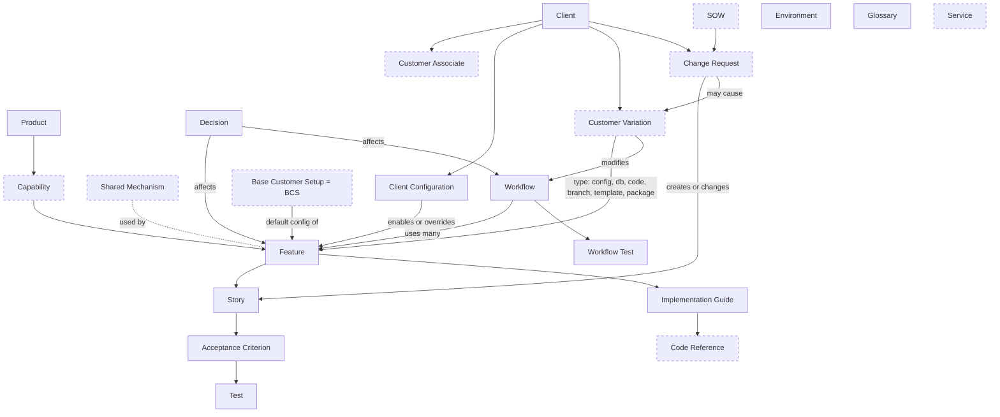

# AIDLC Master Context File: Implementation Focus

Compiled 2026-11-09 for Sourish Pasula (Customer Implementation Lead). Source material: the AIDLC handoff files (10/19, 11/02, 11/05), the three-week plan, the 11/10 meeting kit, the capstone goals document, the kickoff deck, and the 11/03 mentor meeting transcript.

**CONFIDENTIAL.** This file contains Smart Data Solutions (SDS) project information covered by the NDA. Keep it on SDS-approved or course-approved private systems only. Do not post it to a public repo, a public chat, or any outside service.

**Precedence rule when sources disagree:** newest wins. Order from newest to oldest: this file's Section 3 (11/03 outcomes and 11/05 updates), the 11/05 Zina and Sourish handoff, the 11/02 three-week plan and tech brief, the 10/27 meeting outcomes, the 10/20 meeting outcomes, the 10/19 handoff.

---

## Table of contents

1. Project in one page
2. Team and roles
3. Rules that always apply
4. Timeline and key dates
5. Decisions in force
6. Meeting history (10/20, 10/27, 11/03)
7. Framework findings (DDPD current state)
8. QuickClaim discovery summary
9. Implementation work packages (the main section)
10. Sourish track in detail (BCS and CENCORP)
11. Week-by-week schedule
12. 11/10 meeting kit
13. AI baseline and rerun
14. Validation plan
15. Information model reference
16. Open questions
17. Conflicts and things to confirm
18. Risks
19. Deliverables checklist and charter goals
20. Work log template
21. Prompts to start a new Claude session

---

## 1. Project in one page

- **Course:** UT Dallas CS 4485 capstone, Fall 2026. Faculty advisor: Professor Yi Zhao.
- **Sponsor:** Smart Data Solutions (SDS), a healthcare process automation and interoperability company. Mission: make healthcare efficient with automation. Dallas COET office at 5445 Legacy Drive, Plano, Texas.
- **Project name:** AIDLC: AI-Ready Documentation Retrofit, also called Documentation-Driven Product Development (DDPD).
- **Problem:** Knowledge about SDS's product QuickClaim lives in source code and in a few experts' heads. AI tools cannot be given database access because of patient information (PHI). Documentation has to become the main way people and AI tools understand what the system does and why.
- **What we build:** Finish SDS's DDPD framework (structure, templates, IDs, traceability, customer model, governance). Prove it by documenting the Base Customer Setup (BCS) and the customer CENTENE (QuickClaim code CENCORP) in Digital Mailroom and the Appeals workflow. Then inventory the rest of QuickClaim.
- **Charter goals:**
  - Goal 1: Complete the DDPD information model (concepts, relationships, locations, fields, templates, traceability, customer model, governance).
  - Goal 2: Validate against a real customer (CENTENE). Base Customer Setup, CENTENE differences, two-way traceability, human and AI usability, show a new customer can be added without structural change.
  - Goal 3: Document standard QuickClaim product behavior. Agreed scope: only Digital Mailroom gets full docs, everything else is inventory level, Clearinghouse is listed by name only.
  - Goals 4 to 7 (AI workflows, drift prevention, MCP strategy, documentation portal) are stretch. Out unless there is spare time.
- **Out of scope for the whole project:** production software features, production AI integrations, repository automation, production integrations with external systems.
- **SDS expectations (kickoff deck):** outcomes are reduced tribal knowledge dependency, faster onboarding, improved implementation efficiency, better support and maintenance, future-ready AI enablement. Deliverables are a documentation framework package, product knowledge repository, reusable implementation toolkit, knowledge portal prototype (stretch), and a final strategic recommendation.

---

## 2. Team and roles

| Name | Role | Notes |
|---|---|---|
| Sourish Pasula | Customer Implementation Lead | Owns BCS docs, CENCORP docs, YAML config copies. Checks every copied setting is safe and sourced. |
| Zina Abou Assali | Documentation Standards Lead | Owns templates, lifecycle matrix, governance, human usability sessions. |
| Obinna Anaenugwu | Technical and AI Lead | Owns information model, traceability model, IDs, validation, code discovery. |
| Aima Salman | Project Coordinator and Sponsor Liaison | Owns AI baseline and rerun, inventory, work package tracker, scheduling with Zach. |
| Zach Polfliet | SDS mentor, Senior Manager of Product Development | Technical contact. Reviews every merge request. Controls GitLab branch protection. |
| Hasya Padarthi | SDS mentor, Business Automation Manager, Project Manager | Weekly status meetings, presentation logistics. |
| Vicki Lee | Executive Sponsor | |
| Kristofer Fitzgerald | CEO Advisor (SDS) | Listed in kickoff deck. |
| Patrick Bores | CTO (SDS) | Listed in kickoff deck. |

**Turn-taking:** Pairs alternate. Zina and Sourish own the week of 11/05 to 11/10 and present on 11/10. Obinna and Aima take over after 11/10 and run the week to 11/17.

**How work gets done:** A Claude workspace drafts most of the implementation. Each track owner reviews, fixes, and owns the result. Zach reviews before anything merges. Run one Claude session per track if possible, and only one session writes to each set of files.

---

## 3. Rules that always apply

1. **No PHI, patient data, member data, or real customer records** in any document, example, or YAML. Use made-up data.
2. **No credentials, keys, tokens, connection strings, or internal hostnames** in any document or YAML.
3. **Everything is confidential under NDA.** Keep it on SDS-approved systems. Never suggest public repos or outside services.
4. **The QuickClaim repo (`smartdatasolutions`) is read only.** Never modify it.
5. **DDPD changes go on a feature branch** in the real SDS GitLab DDPD repo (`documentation-driven-product-development`), for example `feature/ddpd-sprint3-<track>`. Never push to `main`.
6. **Do not push at all until Zach confirms branches are protected** and every team member has full (not guest) access. Until then, draft locally.
7. **Work in the real GitLab repo, not the downloaded zip.** Clone over SSH (HTTP does not work for Zach). Editing directly in GitLab is also fine.
8. **Nothing merges without Zach's review.** One small merge request per work package.
9. **Mark anything unconfirmed as `unverified`.** Do not guess how QuickClaim behaves.
10. **Writing style:** plain, simple. No em dashes. No semicolons. Markdown following DDPD templates and naming unless proposing a change. Explain reasoning and tradeoffs for every structural proposal.
11. **Keep a log** of what Claude drafted and what each person reviewed or changed. Needed for honest progress reports and the course AI-use policy. Template in Section 20.
12. **Sensitive repo hygiene items** from the discovery report (credential and key files, one possible mass-assignment pattern) are raised privately with Zach through Aima. Never put them in project documents. A tracked customer change notice `.docx` exists in the QuickClaim repo root. Do not open it until SDS confirms it has no member data.

---

## 4. Timeline and key dates

### Milestones (use on status reports)

| Milestone | Date | Status |
|---|---|---|
| Kickoff | 09/09/26 | Complete |
| Sprint 1: Review / discovery | 10/19/26 | Complete |
| Sprint 2: CSA, lifecycle, models | 11/02/26 | Complete (confirm CSA and lifecycle are done) |
| Sprint 3: Framework, base customer, CENTENE | 11/15/26 | On track (At risk if BCS slipped) |
| Sprint 4: Validation, governance, recommendation | 11/22/26 | On track |
| Final presentation | 12/01/26 | On track (confirm, see Section 17) |

The project is now **four sprints**, not five. Sprint 3 is weeks 1 and 2 of the plan, Sprint 4 is week 3, then only sponsor feedback and the final presentation remain.

### Three-week shape

| Week | Dates | Theme | Mentor meeting |
|---|---|---|---|
| 1 | 11/03 to 11/08 | Framework: IDs, templates, models, AI baseline | Tue 11/03 (done) |
| 2 | 11/09 to 11/15 | Customers: BCS, CENCORP, inventory, standard docs | Tue 11/10 |
| 3 | 11/16 to 11/22 | Prove and package: validation, usability, analysis, recommendation | Tue 11/17 |

### Zach review windows (per the plan)
1. 11/05 to 11/06: IDs, templates, models.
2. 11/11 to 11/12: BCS and CENCORP.
3. 11/18 to 11/19: validation results, governance, gap analysis.

Note: on 11/03 Zach said he expects to review BCS and CENCORP at the **11/17** meeting. See Section 17.

### After 11/22
- 11/23 to 11/25: apply final sponsor feedback, finalize recommendation, build presentation.
- 11/26 to 11/29: Thanksgiving, light, rehearse.
- Mon 11/30: final rehearsal.
- Tue 12/01: final presentation at SDS Plano (unconfirmed).

### Daily rhythm
15-minute team check-in each day. Aima updates the work package tracker (Not started, Drafting, In review with Zach, Changes requested, Approved, Merged). Anything blocked for more than a day goes to Zach as a short message through Aima.

---

## 5. Decisions in force

### 5.1 Structure
1. **Hierarchy: Product > Capability > Feature > Story.** Sponsors accepted it.
   - **Capability** (Zach, 10/20): a part of a product that a customer can have enabled or disabled. Every capability has at least one feature that describes it. Examples: Fax Intake, SFTP Intake, API Intake, Mailroom Intake.
   - Note in docs that the DDPD "capability" is narrower than the SDS taxonomy "capability" (a reusable building block not sold alone).
2. **Appeals is a workflow,** not a product. It uses two products (which two is open). A feature belongs to one product. A workflow connects features and can span products.
3. **SDS taxonomy spreadsheet** (Solution, Product Family, Product, Capability, Service, Product Enhancement) is **reference vocabulary only.** No restructuring. Optional uses: "Service" for people-delivered work such as physical mailroom operations, "Product Enhancement" for CRs that improve an existing feature, and the test questions as plain classification rules in governance.
4. **Customer settings are copied into YAML** in the docs using safe-copy rules. Record the source (file path, or table and column) of every copied value. SDS may later make QuickClaim read these files, which would make the docs the source of truth.
5. **Environments:** local, test, prod. No QA yet (leave room for it). Some places use other names.
6. **Scope:** CENTENE only. Clearinghouse does not need review.
7. **Feature IDs stay globally unique** and do not encode the hierarchy, so moving a feature never breaks links. Every product and capability folder has a short index of its children. A shared or platform layer documents cross-cutting mechanics once.
8. **Stories do not move between features.** If one must, it gets a new STID and the old one points to it.

### 5.2 IDs (approved 11/03)
- Readable keys kept, for example `FTID-DOCSPLIT`. Zach: "I'm fine with your format."
- **All new prefixes approved.** 15 types: PDID (product), CPID (capability), FTID (feature), STID (story), ACID (acceptance criterion), TCID (test case), WFID (workflow), SHID (shared mechanism), SVID (service), CLID (client), CLID sub-client (customer associate), CRID (change request), VRID (customer variation), DCID (decision), ENID (environment).
- **File names stay descriptive** (for example `docsplit-feature.md` or a folder named for the feature). Putting the ID in the file name is optional. Pick one convention and use it everywhere.
- **Sub-clients map to customer associates** (the CUSTOMER_ASSOCIATE table, often a line of business). Zach knows of only one customer associate for CENTENE. Long IDs are fine. Sub-client data may be customer sensitive. If a deeper level is needed later, add another prefix.
- **Rules:**
  - One readable format per type: prefix, short readable key, number where needed.
  - Keys never change and are never reused.
  - Keys are unique across products, capabilities, features, and workflows (extend to all keyed types so `TCID-<KEY>` is never ambiguous).
  - No folder paths in IDs.
  - Tests do not put criteria inside their own ID. Each test has a **Validates** list. In code, those values go in JUnit 5 `@Tag` values. Tags cannot contain spaces or the characters `, ( ) & | !`. IDs use only letters, digits, and hyphens, so they are valid.
  - Anything created by a change request carries the CRID.
  - Customer-only items also carry `Client:` and are marked contractual.
  - Each ID has **one owning file.** Other files only reference it. Intended pairs: a test doc and its JUnit tag, a client md and its config YAML. Validation flags duplicates and links to IDs that do not exist.
- **Example formats (proposed, confirm before treating as final):**
  - Product: `PDID-DIGITALMAILROOM` (or `PDID-DMR`). Do not use `PDID-MAILROOM`, which is easy to confuse with the Mailroom Intake capability.
  - Feature: `FTID-DOCSPLIT`
  - Story: `STID-DOCSPLIT-001`
  - Client: `CLID-CENCORP`
  - Customer associate: `CLID-CENCORP-<ASSOC>`
  - Change request: `CRID-CENCORP-003`
  - Variation: `VRID-CENCORP-002`
- **Before and after:** Today a story might be `STID-DOCSPLIT-001` or `FTID-DOCSPLIT-STID-001`. Under the proposal it is always `STID-DOCSPLIT-001`. A test that checks two criteria gets one TCID and lists both in Validates.
- **Seven ID problems the proposal fixes:** story format conflict between spec and template, tests can name only one criterion, subtests have no ID, decision IDs collide (every folder starts at 001), no ID for workflows, clients, change requests, or variations, and criteria embedded in test IDs.
- IDs may still change in small ways. Keep them easy to find and replace.

### 5.3 Change requests (Zach's top priority, 10/27)
- A customer change request (CR) can become one of three things: **customer-only**, **enhancement**, or **product change**. Track both the CR and what it became.
- The CR is its own document in the client folder, for example `CRID-CENCORP-003`. It records what was asked, a required **Reason**, the outcome type, and everything it created or changed.
- Everything a CR created carries `Change request: CRID-...`.
- Items from a **customer-only** CR also carry `Client:` and are marked **Contractual: yes**, so people and AI agents do not change or delete them freely. Enhancements and product changes never carry `Client:`.
- Every change has an audit reason. SDS is audited often. A change must link back to the CR that caused it.
- **Trace chain:** client > change request > feature or story > acceptance criteria > tests.
- **Customer termination use case:** if a customer leaves, an agent (even a cheap model) follows links from the client folder, finds everything tied only to that customer, checks whether any other customer uses the same piece, and lists what can be safely removed. Goal: remove code bloat from code nobody touches because nobody knows who uses it. This is the main Goal 2 proof, run in week 3.
- The termination search only works if every customer-specific item carries a `Client:` or `Change request:` field. Make it required on features, stories, and variations that exist for one customer.
- CENCORP may have no formal CRs. Implementation-specific needs still count. **Zach's example:** CENCORP has documents that must be labeled a certain way for its own workflow, used by no one else. Record that as a CR or variation so it can be found and removed later.

### 5.4 Customer differences (variations)
- Not every difference is a CR. Many are config or code overrides of BCS. These are **variations** (`VRID-CENCORP-002`). A variation always carries `Client:`, points to the feature it changes, and points to the CR that caused it if there is one.
- **Six variation types:** config, database, code override, hardcoded branch, custom template, custom package.
- **Customer associate:** a sub-client or line of business under a customer.

### 5.5 CENCORP plan names (update 11/05, still awaiting Zach)
- Centene, WellCare, Fidelis, and Health Net appear in CENCORP code. A read-only code check found they are **destination platforms**, not customer associates.
- Each document gets a platform from its destination platform assignment (matched by payer ID, default Centene). The platform maps to an export group code (`CENCORPWELLCARE`, `CENCORPFIDELIS`, `CENCORPHEALTHNET`, `CENCORPCENTENE`), which picks the EDI config file, the 837 claim class, and the 275 builder. Member reimbursement and reclamation are also group codes but not plans.
- **Proposal sent to Zach, awaiting answer:** sub-client IDs only for real customer associates. List the four plans as destination platforms in the CENCORP client config (a list field, not IDs). Record each per-plan difference as a variation.
- **Draft CENCORP that way and mark it unverified** until Zach answers. Do not create plan-level sub-client IDs.

### 5.6 Model fixes from Obinna's review (apply now)
1. `Client` and the contractual flag only go on items from customer-only outcomes. Variations always carry `Client`.
2. Test case files are named and found by TCID.
3. Client back-reference lists on product docs may not scale. Prefer links from the client side and let validation build the reverse view. Flag as an open decision.
4. Stories do not move between features (see 5.1 item 8).
5. Reason is a required field on every CR.
6. Lifecycle docs missing from the model: release notes, user guides, runbooks, BRDs. Add them or mark them out of scope.
7. Do not claim anything was "sent" to Zach unless it actually was.
8. Add SHID (shared mechanism) and SVID (service) to the models.
9. Add the 11/03 answers: readable feature keys, all prefixes approved, descriptive file names, sub-clients equal customer associates.

---

## 6. Meeting history

### 6.1 Kickoff (09/09/26)
Sponsor introduced the AIDLC capstone. Project objectives: establish documentation governance, create an AI-ready knowledge framework, build a centralized documentation library, retrofit existing product knowledge, improve accessibility of product knowledge, enable AI-assisted product understanding. Next steps were NDA signing, weekly status meetings (Hasya), an in-person session at the SDS office, and status reports populated by the UTD team before each weekly meeting.

### 6.2 Zach's guidance from the 9/29 demo
- Known gaps: customer-specific change requests are not represented well, and features may be the wrong top level.
- Design the hierarchy so AI tools read less unrelated documentation per task.
- A feature belongs to one product. A workflow connects features and can span products.
- Keep related pieces grouped (document splitting phases 1, 2, 3 are one capability).
- Same feature, different customer usage: document variations next to the product and feature.
- Functionality that fits no product gets flagged for an SDS decision.
- CENTENE focus: Digital Mailroom and Appeals. CENTENE's appeals differ from the general product.
- Use AI to find code, trace what touches it, and group it into features, stories, and workflows.

### 6.3 Meeting 10/20 (Zach)
- Docs copy customer settings as YAML.
- Appeals is a workflow (Zach leans this way) using two products. Wants a review of how a product is defined versus a workflow.
- Stay focused on CENTENE. Skip Clearinghouse.
- Capability defined as above. Examples under Fax Intake: **Dedicated Fax Lines** (a customer gives a fax number to the people it works with, anything sent to that line goes into QuickClaim, items are labeled differently depending on which line they came in on, a person can also be labeled on a line) and **fax intake reports**. User story example: label incoming items by fax line.
- Features that repeat across capabilities, for example **automated assignment** (teams lock documents and assign them to people), are a candidate for the shared layer.
- SDS taxonomy spreadsheet received 10/26 (reference only).
- The 10/20 note "CENTENE is CEN" was wrong and was corrected on 10/27.

### 6.4 Meeting 10/27 (Zach)
1. **CENTENE's customer code is CENCORP.** Remove any "CEN validation" or "do not assume CENCORP matches CEN" items. The discovery report's CENCORP findings are the CENTENE findings.
2. No major issues with the plan. The team can start implementation once repo access is set up.
3. Two templates (feature and story) are not enough. A change request template is a good addition. More are expected.
4. IDs chosen for human readability. Asked for concrete examples of current problems and the proposed fix.
5. QuickClaim has local, test, prod. No QA.
6. No docs folder in QuickClaim is expected. Applying DDPD to QuickClaim is the point.
7. Capability vs. taxonomy wording is resolved.
8. Work in the real GitLab repo. Aima is a full member (guests see an empty repo). Zach is protecting branches and adding everyone. Clone over SSH. Do not push until branches are protected.
9. Change request guidance (Section 5.3).

### 6.5 Meeting 11/03 (Zach and Hasya, presented by Obinna and Aima)
**Presented:** key accomplishments (review held, change request model built, models drafted, ID proposal), status (GitLab access obtained, AI baseline run), issues (cannot push until confirmed, open definitions including which two products Appeals uses, baseline answer key needs SDS review, two baseline questions about fax and SFTP customers cannot be answered from code because those lists are in the database), and next steps.

**Zach's answers to the ID proposal:**
1. Feature key vs number: either, easy to change. Fine with readable keys.
2. New prefixes: yes.
3. File names: not required to include the ID. File names should say what the file is, so editor tabs are not six copies of `feature.md`.
4. Sub-client IDs: sub-clients in QuickClaim are customer associates. He knows of only one for CENTENE and asked where the team found Centene, WellCare, Fidelis, Health Net, and whether the team was looking at the test or production branch. Offered to guide if given the file. Long IDs are fine.
5. He asked whether any ID would need to appear in more than one file. Answer: one owning file per ID, intended exceptions listed in Section 5.2.

**Timeline Zach walked through:** 11/03 baseline and ID review (done). Rest of week: information model, traceability model, templates, lifecycle matrix. 11/10 meeting: then the week of BCS, CENCORP docs, QuickClaim inventory, standard Digital Mailroom docs. 11/17: Zach expects to review BCS and CENCORP. Week after: traceability validation (traversing the IDs). Final: first week of December.

**Goal alignment:** Zach asked how the plan lines up with the original goals and what will not be delivered. Answer: Goal 3 only gets full docs for Digital Mailroom, the rest is inventory level, Clearinghouse is name only, stretch goals are out unless there is time.

**Final presentation:** Zach said the school presentation is online. Usually about a week before it, the team is invited to the SDS Plano office (Wipro building, near Legacy West) to present in person to SDS executives. Confirm this year's setup with Hasya.

---

## 7. Framework findings (DDPD current state)

### 7.1 What the repo contains (downloaded copy)
`documentation-driven-product-development.md` (spec, about 650 lines), `roadmap.md`, `ddpd-gaps.md` (GAP-001), `AI-first-product-development.md`, `templates/feature-STAR.md`, `templates/feature-STAR-story-STAR.md`, and an empty `CLAUDE.md`. No `/docs` tree exists. The folder structure is only described in the spec.

### 7.2 Concepts the spec defines
Product Context, Roadmap, Decision (Product, Architecture, Workflow), Feature, Feature Implementation Guide, User Story, Acceptance Criterion, Test Case (story, feature, workflow level), Workflow Context and Workflow Configuration (YAML), Client Context and Client Configuration (YAML), Environment (YAML), Glossary and business terms.

### 7.3 The 15 gaps
1. Only two templates exist. None for Implementation Guide, Test Case, Workflow, Client, Decision, Product Context, or Environment.
2. Story ID format conflicts between spec and template. ACID and Test ID formats repeat the chain differently.
3. Story template is missing spec fields (functional requirements, dependencies, assumptions, edge cases, user role breakdown). Title typo `User Story;`.
4. Product Context "Business Problems" section has a copied bullet and a cut-off sentence.
5. Single product only. No product field on features. No capability or epic level.
6. Decision IDs can collide (each subfolder starts at `decision-001.md`).
7. Workflow-level tests are defined but have no folder.
8. Traceability is one-way. No required back-links. Template links are placeholders.
9. Thin customer model. No change requests, no SOWs (only in roadmap), no base customer, no variations tied to a feature. Routing rules appear in both workflow config and client config.
10. No code reference field anywhere, not even in the Implementation Guide.
11. Lifecycle gaps. BRDs required by governance but never defined. Release notes and user guides only in roadmap. Nothing covers support or deployment.
12. Single Source of Truth tension. Resolved 10/20: copy settings into YAML.
13. Environments: spec assumes local, test, QA, production. QuickClaim has local, test, prod.
14. The AI SOP names specific vendors, against the "AI Agnostic" principle.
15. GAP-001 (no place to say "this criterion has no test yet, and why") matters because QuickClaim has very few tests.

### 7.4 Still to check
GitLab `main` vs. the downloaded copy. The `aws-ci-spark` project docs referenced in GAP-001 (the only known real use of the framework).

---

## 8. QuickClaim discovery summary

Source: read-only discovery report, commit `65a5e8621e31afd63a6fa90e901ebdcc158fff7e`, branch `master`. Branch question is open (Section 16).

### 8.1 Codebase shape
- About 54,000 tracked files, about 38,500 Java. Single Gradle module (Ant files also exist, which CI uses is unverified). Java 8 default.
- Web framework: Apache Turbine 2.2 with Velocity 1.2 templates (about 1,470 screens). Routes in `quickclaim/WEB-INF/web.xml` plus Turbine config. About 50 Velocity pull tools and about 265 action classes.
- Preact vendored and served as static ES modules (about 86 files, mostly `*Beta.js` and `*V2.js`). No bundler.
- About 1,020 background jobs extend `SDSJob`. Schedules and enable flags live in the `SDS_HEARTBEAT` table. What launches jobs in production is outside the repo (unverified).
- Torque 3.0 ORM (about 650 tables in the main schema) plus custom prepared statements. No migrations tool.
- The repo has a `CLAUDE.md` and `.claude/commands/`.

### 8.2 Product areas (inferred, unverified as official)
Digital Mailroom, Appeals (as workflow queues), Claims data and X12 EDI, Clearinghouse and provider portal, Remittance and EOB, Eligibility and member matching, Provider matching and repricing, Intake (may be its own product), Medical records and bill review, Correspondence and letters, Billing and internal ops, Reporting and BI, Member portal. `J/clients/` holds 576 per-customer subpackages. The `SDS_PRODUCT_GROUP` table may hold the official product list.

Items that fit no product (flag for SDS): `grubhub`, `hl7`, `hipaatracker`, `mmsea`, `cms`, customer-named packages outside `clients/` (`bluesquared`, `casystems`, `guardian`, `anthem`, `highmark`, `ibc`), assorted tooling (`inkscape`, `pdftk`, `nominatim`, `googledrive`, `sharepointapi`, `gpg`, `migrator`, `tableload`, `threats`, `mpir`), and possible leftovers (`luminx` next to `luminix`, `Andy*` test screens, `newDirectoryTest`).

### 8.3 Digital Mailroom
- Five entry points: home queue board and Intake Dashboard, Open Batch Summary, Page Identification, Document Split Queue, Data Entry Queues.
- **Key phases are shared.** Every keying queue uses phase 1 (first key), phase 2 (second key by a different person), phase 3 (reconciliation if they disagree). A model can stand in for a keyer. "Splitting phases 1, 2, 3" is this model, served by one template. This is a shared mechanism (SHID candidate, the "double-key model").
- Core data: `BATCH` contains `DOCUMENT` contains `IMAGE` (pages). `DATA_ENTRY_QUEUE` rows are units of keying work with a queue type and key phase.
- Intake channels: scanned paper (Opex, EZScan, about 636 importer subclasses), client-scanned paper, email (IMAP), fax (eFax push, SRFax polling), web upload, FTP and SFTP, intake folder drop.
- Physical operations are tracked in code only by clicks: box receipt, prep, scanning, paper storage and destruction, whitemail packaging.

Candidate features:

| Feature | Main stories |
|---|---|
| Intake Dashboards | Queue board on home page, counts by queue and phase, intake dashboard, intake export |
| Batch Management (Open Batches) | View open batches, per-customer column layouts, drill into batch, QC, EDI errors |
| Page Identification | Queue list, classify pages, reconcile keyers or model, release batch, ML auto identification, Form ID queue, special queues (image, attachment, handwritten, EOB, EOMB) |
| Document Splitting | Mark boundaries, advance phase 1 to 2 to 3, import stacks, automated boundary proposals, create child batches |
| Data Entry Queues | Key fields, save per phase, double-key compare, SmartZone OCR verification, OCR, write back, intake identification keying |
| Intake Channels | Paper, email, fax, web upload, FTP and SFTP, intake folder |
| Physical Mailroom Tracking | Box log, prep and scan times, reports, paper storage, whitemail, role menus |
| Rescan and Exceptions | Rescan request, virtual resplit, client scan review |
| Mailroom to Appeals Handoff | Route correspondence, index appeal metadata, unsorted appeals identification |

Workflows identified: W1 Intake pipeline, W2 Open batch monitoring, W3 Page identification, W4 Document splitting, W5 Data entry, W6 Physical mailroom, W7 Rescan, W8 Mailroom to Appeals.

Updated capability tree (intake rows from Zach, others need rechecking against the new capability definition):

| Capability | Example features | Source |
|---|---|---|
| Fax Intake | Dedicated Fax Lines, Fax Intake Reports | Zach |
| SFTP Intake | to define | Zach |
| API Intake | to define (limited use today) | Zach |
| Mailroom Intake (hosted mailroom) | to define, likely box tracking and scanning | Zach |
| Page Identification, Document Splitting, Data Entry | open: are these capabilities? | open question |
| Shared across capabilities | Automated Assignment and Document Locking | Zach, placement to decide |

### 8.4 Appeals
- **No appeals module, table, or case entity.** An appeal is a `DOCUMENT` with an appeal form id. It becomes a case when a `WORKFLOW_DOCUMENT` puts it in a customer `WORKFLOW_QUEUE`.
- Path: image import, unsorted appeals identification and batch split, optional appeal metadata indexing, routing creates the case, work in workflow queue screens (`WorkflowWebActions`: complete, in research, on hold, notes, forward, letters, assign, approve or decline).
- Two routing mechanisms: about 80 legacy per-customer routers (rules in `PREFERENCE` rows), and a newer properties-driven router (`J/jobs/correspondencerouting/`) reading `resources/customer_configuration/<CODE>/correspondence_routing_rules.properties`. **Only BCS (base) and CENCORP use the new router today.** BCS uses it with no rules.
- Candidate features: unsorted appeals identification, appeal classification, appeal metadata indexing, rule-based routing, case work UI, acknowledgment letters, export to client systems, TAT and volume reporting, appeal-specific claim edits.
- Six-step Appeals handoff from Digital Mailroom into workflow queues was presented 10/27.

### 8.5 How QuickClaim varies by customer
1. **Config override:** per-customer properties in `resources/customer_configuration/<CODE>/`, layered over **BCS**, the base.
2. **Database config:** `CUSTOMER` and `CUSTOMER_ASSOCIATE` columns, `CUSTOMER_PROCESS` (switches features on per customer and gates dashboard links), `PREFERENCE`, about 36 `CUSTOMER_*` tables.
3. **Code override:** subclass named `<CODE>Foo`, found by reflection, falling back to the generic class. The dominant pattern.
4. **Hardcoded branch:** about 700 Java lines and 400 Velocity lines compare customer codes.
5. **Customer template or JS:** about 524 customer-prefixed `.vm` files.
6. **Customer-only package:** 576 packages under `J/clients/`.
- No feature-flag framework.
- The `CUSTOMER_PROCESS` process code list is a high-priority input, since it may give the capability list directly (our inference, unverified).

### 8.6 CENTENE (CENCORP) differences found
Discovery found CENCORP in about 147 files (CEN is an older code, also a line of business inside the ILS customer). Differences, with paths in the discovery report:
- Client-vendor scan import (CenScan)
- Custom auto identification and page identification backends
- Destination platform assignment by payer and plan
- Shoring and routing API
- Custom data capture routing and keying queues
- 837 and 275 EDI builders
- About 55 reject edits
- Custom export and reject export
- Eligibility file load
- Event push to a Centene API
- Appeal and volume reports
- Virtual rescan imprint handling
- SSO
- Invoicing
- **Properties-driven correspondence routing rules for appeals, legal, and other correspondence**

### 8.7 Tests and docs in QuickClaim
JUnit 5 only. 25 test files, about 281 test methods. `@Tag` used once. A custom annotation precedent exists (`LiveDbTest`), so a criterion-id annotation that composes `@Tag` fits local style. No product docs, ADRs, or design notes in Markdown.

### 8.8 Discovery gaps still open
1. Where page identification data entry rows are first created.
2. Generic data entry backend internals.
3. FTP and SFTP handlers.
4. Scan review callers.
5. Appeals internals beyond the CENCORP routing path.
6. How jobs are scheduled in production.
7. List of `CUSTOMER_PROCESS` process codes.

---

## 9. Implementation work packages (the main section)

Submit each package as its **own small merge request.** Mark anything not confirmed as **unverified.** Pushing waits for branch protection. Never push to `main`.

### WP1. Templates (owner: Zina). Target: in review by 11/10.
Write or fix one template per document type. Start with change request. Every template uses approved ID formats and says which fields are required. Use made-up data in all examples (for example a fake feature DOCSPLIT and a fake CR).

| Template | New or fix | Must include |
|---|---|---|
| Change Request | New | CRID, client, what was asked, **Reason (required)**, outcome type (customer-only, enhancement, product change), contractual flag, created items list, SOW reference, dates, approver |
| Feature | Fix | FTID, product and capability fields, `Client` and `Change request` fields (only when they apply), back-reference list, code references link |
| User Story | Fix | STID format fixed, functional requirements, dependencies, assumptions, edge cases, acceptance criteria with ACIDs, fix the `User Story;` title typo |
| Test Case | New | TCID, Validates list of ACIDs, level (story, feature, workflow), type (unit, integration, e2e), coverage status per GAP-001, note that Validates values go in JUnit `@Tag` |
| Feature Implementation Guide | New | Code references section (paths, classes, templates, tables, jobs) |
| Product Context | Fix | Fix the copied bullet and cut-off sentence |
| Capability index | New | CPID, short list of features with one line each, how a customer turns it on or off |
| Workflow Context and Config (YAML) | New | WFID, products and features used, steps |
| Client Context and Config (YAML) | New | CLID, customer associates, enabled capabilities, links to variations and CRs, source of every copied setting |
| Customer Variation | New | VRID, client, variation type (six types), base behavior it changes, link to CR if any |
| Decision | Fix | DCID, type as a field |
| Environment (YAML) | New | ENID, local, test, prod |

### WP1b. Product lifecycle matrix (owner: Zina). Draft by 11/06, then refine.
A table of product and feature stages (for example request, design, build, test, release, change, retire) and which DDPD document is created or updated at each stage. Include where change requests, release notes, user guides, and runbooks fit. Mark gaps where DDPD has no document yet.

### WP2. Information model doc (owner: Obinna). In review by 11/10.
- Every concept: one-line definition, required and optional fields, folder location, product level vs. customer level.
- Include change request, customer variation, customer associate, capability (with Zach's definition), shared mechanics (for example the double-key phase 1, 2, 3 model), and service (taxonomy term for people-delivered work).
- Include a Mermaid concept diagram (Section 15).
- Apply the fixes in Section 5.6.

### WP3. Traceability model doc (owner: Obinna). In review by 11/10.
- ID rules from Section 5.2.
- Link rules: for each link, which side is the source of truth and the required back-reference on the other side.
- The change request chain.
- How tests link to criteria in Markdown and in JUnit `@Tag`.
- Coverage notes for criteria with no test (GAP-001).

### WP4. BCS base customer docs (owner: Sourish). DONE BY 11/09 (today).
- BCS client context md and client config YAML.
- Copy **safe** settings only. Never copy credentials, keys, tokens, hostnames, connection strings, or any patient or member data.
- Record the source of every copied value (file path, or table and column) so it can be rechecked.
- BCS is the base. Be clear about what BCS does by default, because every CENCORP difference later becomes a variation from it.

### WP5. CENCORP docs (owner: Sourish). Half by 11/15, done by 11/24 (Zach review expected 11/17).
- Client context and config YAML, associates.
- Variations from BCS in Digital Mailroom (fax, SFTP, API, mailroom intake and related features).
- The Appeals workflow as CENCORP uses it (properties-driven routing rules).
- Change requests or implementation-specific needs, including the document labeling example.
- Plans as destination platforms, unverified (Section 5.5).

### WP6. Validation (owner: Obinna, with Aima on the AI rerun). Done by 11/24. Runs in week 3 (11/16 on).
- **Forward:** from CENCORP, find every feature, capability, and workflow it uses.
- **Reverse:** from a feature, find every customer that uses it and how.
- **Termination test:** from CENCORP, find everything tied only to CENCORP and correctly skip anything shared. Use a small or cheap model to prove the traceability is good enough, as Zach described.
- **Second-customer dry run:** add a made-up second customer to prove the structure does not need to change (Goal 2). No framework changes allowed during the dry run.
- **AI usability rerun:** rerun the baseline questions against the new docs, same setup, and compare.
- **Human usability test:** 5 to 8 people, same task list, about 20 minutes each (run by Zina, 11/18).

### WP7. Inventory (owner: Aima). Draft by 11/09.
QuickClaim product and feature inventory. Fields: name, one line, status, used by CENCORP, confidence. Drafted from the discovery report. Clearinghouse is name only.

### WP8. Standard Digital Mailroom docs (owner: Aima and Zina). 11/11 onward.
Fully drafted standard behavior docs for Digital Mailroom features CENCORP does not use. The rest of QuickClaim stays at inventory level.

### WP9. Governance (owner: Zina). Draft 11/12.
Short rules plus a drift check process. Cover: rules for introducing new concepts, consistency rules, ownership and maintenance, and the SDS taxonomy test questions as plain classification rules.

### WP10. Gap and improvement analysis (owner: Zina, Obinna, Sourish). 11/19.
Missing concepts, redundant concepts, inconsistencies, recommendations. Fix gaps found in validation.

### WP11. Final recommendation (owner: Obinna). Draft 11/20.
Include numbers: AI accuracy, time to find, termination test result, usability results. Explain why the model was chosen, alternatives considered (hierarchy Options A, B, C), tradeoffs, risks. Note the DDPD vs. taxonomy "capability" wording.

### WP12. Status reports and course paperwork (owner: Aima, all contribute).
Weekly status report in the one-page landscape dashboard format. Meeting minutes and progress reports with honest per-person work and hours.

---

## 10. Sourish track in detail (BCS and CENCORP)

### 10.1 BCS (WP4), due 11/09
**Files to produce:**
- BCS client context (Markdown) using the Client Context template.
- BCS client config (YAML) using the Client Config template.

**Where BCS settings come from (from discovery):**
- `resources/customer_configuration/<CODE>/` properties files (BCS is the base layer).
- `CUSTOMER` and `CUSTOMER_ASSOCIATE` columns.
- `CUSTOMER_PROCESS` (switches features on per customer).
- `PREFERENCE` rows.
- About 36 `CUSTOMER_*` tables.

**Known BCS facts:** BCS uses the properties-driven correspondence router with no rules. CENCORP has rules for appeals, legal, and other correspondence.

**Safe-copy checklist (apply to every value):**
- Behavior setting only? (feature on or off, queue name, routing mode, thresholds, file formats)
- Not a credential, key, token, hostname, connection string, URL with embedded secret?
- Not patient or member data, and not a real customer record?
- Source recorded (file path, or table and column)?
- If unsure, leave it out and mark the gap `unverified`.

**Suggested YAML shape (illustrative, adjust to the approved template):**

```yaml
id: CLID-BCS
name: Base Customer Setup
type: base-customer
environment_scope: [local, test, prod]   # confirm
associates: []                           # confirm whether BCS has any
enabled_capabilities: []                 # from CUSTOMER_PROCESS codes, source required
settings:
  - key: correspondence_routing_mode
    value: properties-driven
    source: resources/customer_configuration/BCS/correspondence_routing_rules.properties   # example path, verify
    status: unverified
variations: []        # BCS is the base, so empty
change_requests: []
```

### 10.2 CENCORP (WP5), half by 11/15, done by 11/24

**Step order:**
1. Client context and config YAML (`CLID-CENCORP`). Copy safe settings, record sources.
2. Destination platforms list (Centene, WellCare, Fidelis, Health Net) in the config as a list field. Mark unverified. No sub-client IDs for them.
3. Variations from BCS (`VRID-CENCORP-nnn`). One file per variation. Each one carries `Client: CLID-CENCORP`, the variation type (one of the six), the feature it changes, the BCS base behavior it differs from, and the CRID if any.
4. Appeals workflow as CENCORP uses it (`WFID-` for Appeals). Properties-driven routing rules for appeals, legal, other. Note BCS has the same router with no rules.
5. Change requests and implementation-specific needs (`CRID-CENCORP-nnn`). Each one needs Reason, outcome type, contractual flag, created items, SOW reference if known.
6. Back-references and links so the forward, reverse, and termination tests can run.

**Candidate variations from the discovery list (each needs verification and a type):**

| Candidate | Likely variation type | Notes |
|---|---|---|
| Client-vendor scan import (CenScan) | code override or custom package | Intake channel difference |
| Custom auto identification and page identification backends | code override | Page Identification feature |
| Destination platform assignment by payer and plan | config plus code override | Platform maps to export group code |
| Shoring and routing API | custom package | API Intake relevance, unverified |
| Custom data capture routing and keying queues | config or code override | Data Entry Queues |
| 837 and 275 EDI builders | code override | Per export group code |
| About 55 reject edits | code override | Likely one or a few variations, group sensibly |
| Custom export and reject export | code override | |
| Eligibility file load | custom package or job | |
| Event push to a Centene API | custom package | Needs a CR or reason, unverified |
| Appeal and volume reports | custom template | |
| Virtual rescan imprint handling | code override | Rescan and Exceptions |
| SSO | config or custom package | |
| Invoicing | custom package | |
| Correspondence routing rules (appeals, legal, other) | config | The properties-driven router |
| Document labeling (Zach's example) | likely customer-only CR | Documents labeled a certain way for CENCORP's workflow only |

Do not paste real values from these. Describe behavior and point to the source path.

**Change request candidates to prepare:**
- Document labeling (Zach's example). Outcome type likely customer-only. Contractual: yes. Carries `Client: CLID-CENCORP`. Reason: the customer's own workflow needs it, no other customer uses it. Mark facts unverified until confirmed.
- Any implementation-specific need found in the variations above that has no formal CR. Record as a CR or a variation so it can be found and removed later.
- Ask Aima for redacted CENTENE SOWs and change requests (requested 10/20, status unknown).

### 10.3 Termination-test readiness check for CENCORP docs
Before week 3, confirm for every CENCORP-specific item:
- It carries `Client:` (if customer-only) or `Change request:`.
- It links to the feature it changes.
- It is marked contractual if from a customer-only CR.
- Anything shared with BCS or other customers is NOT marked customer-only.

---

## 11. Week-by-week schedule

### Week 1 (11/03 to 11/08): framework
| Day | Must happen | Owner |
|---|---|---|
| Tue 11/03 | Mentor meeting. Send ID proposal. Ask for review windows and branch protection. | Obinna, Aima |
| Tue 11/03 | Draft baseline question set and answer key. | Aima |
| Wed 11/04 | Run AI baseline. | Aima |
| Wed 11/04 | Templates drafted (CR first). Models drafted. Branch protection confirmed, everyone cloned. | Zina, Obinna, Aima |
| Thu 11/05 | Review window 1. BCS docs started. | Zina, Obinna, Sourish |
| Fri 11/06 | Lifecycle matrix drafted. Apply Zach's feedback on IDs and templates. | Zina, Obinna |

### Week 2 (11/09 to 11/15): customers
| Day | Must happen | Owner |
|---|---|---|
| Mon 11/09 | BCS client docs and YAML finished. Inventory drafted. | Sourish, Aima |
| Tue 11/10 | Mentor meeting: show approved templates and BCS, preview CENCORP. | Zina, Sourish (Obinna and Aima can join) |
| Tue 11/10 | CENCORP docs drafted: client context, YAML, associates, variations, Appeals workflow, change requests. | Sourish |
| Wed 11/11 | Review window 2: MRs for BCS and CENCORP. Standard behavior docs for Digital Mailroom features CENCORP does not use. | Sourish, Aima, Zina |
| Thu 11/12 | Governance rules drafted. Validation prompts and made-up second customer prepared. | Zina, Obinna |
| Fri 11/13 | Apply Zach's feedback on BCS and CENCORP. | Sourish |
| Weekend | Buffer. | All |

### Week 3 (11/16 to 11/22): prove and package
| Day | Must happen | Owner |
|---|---|---|
| Mon 11/16 | Validation: forward, reverse, termination test. AI rerun. | Obinna, Aima |
| Tue 11/17 | Mentor meeting: live traceability demo, before and after numbers. Zach reviews BCS and CENCORP (per his 11/03 statement). Second-customer dry run. | Obinna, Aima, Sourish |
| Wed 11/18 | Human usability test (5 to 8 people). Review window 3. | Zina, Obinna |
| Thu 11/19 | Gap and improvement analysis. Fix gaps from validation. | Zina, Obinna, Sourish |
| Fri 11/20 | Draft final recommendation with numbers. | Obinna |
| Weekend to Sun 11/22 | Merge approved work. Clean up. Status report. | All |

### Dependencies
- Branch protection by 11/04 (confirm). Until then, draft in the workspace.
- AI baseline ran 11/02 and finished before any drafts were visible to it.
- IDs and templates are approved before customer docs are finalized. CENCORP can be drafted earlier then adjusted.
- Unverified facts can ship marked "unverified" with a list for Zach.

---

## 12. 11/10 meeting kit (Zina and Sourish present)

Meeting is **Tue 11/10** with Zach and Hasya. Obinna and Aima can join to answer questions.

### 12.1 Status report layout
One-page landscape dashboard, same as the 11/03 report:
- Orange header: "Program: UTD Capstone Fall 2026", "AIDLC: AI-Ready Documentation Retrofit", "Status Date: 11/10/2026", "Executive Sponsor: Vicki Lee | PM: Hasya Padarthi".
- Project objective box (unchanged text below).
- Green badge: "ON TRACK | xx%".
- Three columns: Key Accomplishments, Issues / Risks, Milestones.
- Two bottom boxes: Next Steps / Planned Activities, Additional Comments.

**Project objective (keep as is):** Complete the DDPD framework so QuickClaim product knowledge becomes an AI-ready source of truth. Validate the framework against CENTENE, expand coverage to standard QuickClaim behavior, and establish governance to keep documentation accurate.

**Percent complete:** 11/03 was 50%. Suggest about 60 to 65% if templates and BCS are done, lower if not. Decide with the team.

### 12.2 Key accomplishments (edit to match what actually got done)
- 11/03 sponsor review: ID proposal approved. Readable keys kept, all new prefixes approved, file names stay descriptive, sub-clients map to customer associates.
- Templates drafted for all document types, starting with change request. (Say which are in review and which are approved.)
- Information and traceability models updated with the 11/03 decisions and review fixes.
- Product lifecycle matrix drafted.
- BCS base customer context and config YAML drafted, with the source of every copied setting recorded.
- CENCORP variations and CR candidates identified (preview).
- Sent Zach the code locations for the CENCORP plan names (only if Obinna has sent it).

### 12.3 Issues and risks
- Branch protection: confirmed or still pending (check).
- CENCORP plan level is unverified until Zach answers. Plan-level IDs on hold.
- Open definitions: which two products Appeals uses, whether processing steps are capabilities, where automated assignment fits.
- Client back-reference lists may not scale. Decision needed.
- Final presentation format and date need confirming.
- Baseline answer key still needs SDS review. Two questions depend on database customer lists.

### 12.4 Next steps (for the report)
- 11/10 to 11/11: finish CENCORP docs.
- 11/09 to 11/15: inventory, standard Digital Mailroom docs, governance rules draft.
- 11/17: sponsor review of BCS and CENCORP.
- 11/16 to 11/22: traceability validation and termination test, AI rerun, usability tests, recommendation draft.

### 12.5 Additional comments (for the report)
Drafts are prepared with AI assistance and reviewed by each track owner. Nothing merges without sponsor approval. Work arrives as small merge requests, one per work package.

### 12.6 Talking points (about 10 to 15 minutes)

**Zina (about 6 minutes):**
1. Since last week: ID proposal approved 11/03. Summarize decisions.
2. Templates: show the change request template first. Walk through the required Reason field, outcome type, contractual flag, created items list. Then list the other templates and status.
3. Lifecycle matrix: where each DDPD document is created or updated across a product's life, and the gaps.
4. Models: both updated with 11/03 decisions. Name one or two changes, for example "Client only goes on customer-only items" and "Reason is required on every change request."

**Sourish (about 6 minutes):**
1. BCS: show the client context and YAML. Explain the safe-copy rule (no credentials, keys, hostnames, or patient data). Every value records its source. BCS is the base, so every CENCORP difference becomes a variation from it.
2. CENCORP preview: the variations found so far and the CR candidates, including Zach's document labeling example. Full drafts come 11/11, Zach reviews them 11/17.
3. What's next: inventory, standard Digital Mailroom docs, then validation the week of 11/16.

### 12.7 Asks for Zach and Hasya
1. Zach: review templates (especially change request) and BCS. Small merge requests, about a 48-hour turnaround.
2. Zach: answer on the CENCORP plan level.
3. Zach: which two products the Appeals workflow uses.
4. Hasya: confirm the final presentation. When is the in-person presentation at SDS Plano and when is the online school presentation?
5. Zach: branch protection, if still pending.
6. Zach: confirm review timing for BCS and CENCORP (11/11 to 11/12 or 11/17).

### 12.8 Likely questions and short answers

| If they ask | Say |
|---|---|
| Why not put the ID in the file name? | You said it is optional. We use descriptive names so editor tabs show what each file is. The ID is inside the file. |
| Can the same ID be in two files? | Each ID has one owning file. Others only reference it. The test doc and its JUnit tag, and the client md and its YAML, are the intended pairs. Validation flags duplicates. |
| How do you know a copied setting is safe? | We only copy behavior settings. Each value lists its source so it can be rechecked. Anything sensitive is left out. |
| What is a variation vs. a change request? | A variation is any way a customer differs from BCS. A CR is the customer's request and reason. A CR can cause variations, but many variations have no formal CR. |
| How will you prove it works? | Week 3: forward and reverse traceability, the termination test with a small model, the AI rerun against the baseline, a human usability test, and a made-up second customer added without changing the structure. |
| What won't be delivered? | Goal 3 beyond Digital Mailroom is inventory level only. Stretch goals are out unless there is time. |

### 12.9 After the meeting
- Write down Zach's and Hasya's answers and update the open questions list (Section 16).
- Write a short handoff note for Obinna and Aima (done, in review, blocked, new decisions). They run the week to 11/17.
- Course paperwork: meeting minutes and progress report for the week, honest about what Claude drafted and what each person reviewed.

---

## 13. AI baseline and rerun

- **Goal:** measure how well AI tools answer QuickClaim questions today so later results show improvement.
- **Owner:** Aima, in a separate fresh session on the company login. The baseline session has access to the QuickClaim code but must not see any new DDPD drafts. Use the same setup for the rerun in WP6. Keep the answer key away from the baseline session.
- **Question mix (about 15 to 20):** where something lives in code ("Where is document splitting saved?"), how it behaves ("What happens when two keyers disagree?"), customer differences ("How does CENCORP differ from BCS for appeals routing?"), traceability ("Which customers use fax intake?").
- **Record for each question:** answer, correct or partly or wrong (scored against the discovery report and mentor answers), time to answer, number of files read or tokens used if available.
- **Baseline result (11/02):** 18 questions. 16 correct, 2 partly correct, 0 wrong. About 1 min 51 s per answer, estimated from one batch run.
- **What to expect:** accuracy is already high, so the expected improvement is in speed and ease of finding answers. Say this up front in the final recommendation.
- **Caveats:** the answer key was drafted from the code and needs SDS review before the score is final. Two questions (fax and SFTP customers) cannot be answered from code because the lists are in the database.
- **Rerun:** same 18 questions, same setup, now with the docs. Save the question set so exactly the same questions are rerun.

---

## 14. Validation plan (Goal 2)

| Test | What it proves | Method |
|---|---|---|
| Forward traceability | Starting from CENCORP, every feature, capability, workflow, configuration, and override it uses can be found | Follow links from `CLID-CENCORP` |
| Reverse traceability | Starting from a feature, every customer that uses it and how can be found | Start at an FTID, find all clients that reference it |
| Termination test | Everything tied only to CENCORP can be found, and anything shared is correctly skipped | Small or cheap model follows IDs from the CENCORP folder and lists what can be removed |
| Second-customer dry run | A new customer can be added without changing the framework | Add a made-up customer using existing templates only. No structure changes allowed |
| AI usability rerun | Docs improve AI answers | Rerun the 18 baseline questions with the same setup |
| Human usability test | Humans can use the docs | 5 to 8 people, same task list, about 20 minutes each |
| Link integrity | No duplicate IDs, no links to missing IDs, back-references match | Manual checks (repository automation is out of scope) |

Record all results with numbers for the final recommendation: AI accuracy, time to find, termination test result, usability results.

---

## 15. Information model reference

### 15.1 Product level vs. customer level
- **Product level (same for every customer):** Product, Capability, Feature, Story, Acceptance Criterion, Test Case, Implementation Guide, Shared Mechanism, Service, Workflow, Decision, Glossary, Environment, Roadmap, and BCS as the default configuration.
- **Customer level (overlay that points to product IDs):** Client, Customer Associate, Client Configuration, Customer Variation, Change Request, SOW.

### 15.2 Link rules
Each link has one source of truth. The other side holds a required back-reference or a validation-built reverse view. Open decision: whether client back-reference lists on product docs stay (may not scale) or whether links live only on the client side and validation builds the reverse view. Team leaning: client side owns the links.

### 15.3 Concept diagram (draft)



### 15.4 Required fields to remember
- Change Request: Reason is required.
- Customer-only items: `Client:` and `Contractual: yes`.
- Everything a CR created: `Change request: CRID-...`.
- Variation: always `Client:`, base behavior it changes, type.
- Test: Validates list, level, type, coverage status.
- Client config: source of every copied setting.

### 15.5 Hierarchy options considered (for the final recommendation)
- **Option A, Product > Feature > Story:** simplest, but large products get long flat feature lists and agents scan all features.
- **Option B, Product > Capability > Feature > Story (chosen):** stable grouping, small index per level so an agent loads one branch. Costs one more level and a shared definition of capability.
- **Option C, Product > Feature > Story with epics as tags:** keeps planning separate but does not fix navigation and tags drift.

---

## 16. Open questions (track answers)

1. Which two products does the Appeals workflow use? (Likely Digital Mailroom and Workflow Queues, interpretation only.)
2. Are page identification, splitting, and data entry capabilities, or only the intake channels?
3. Is automated assignment and document locking one shared feature or one per capability?
4. Client back-reference lists on product docs, or links from the client side only?
5. CENCORP plans (Centene, WellCare, Fidelis, Health Net): does Zach agree with listing them as destination platforms in the client config with variations for per-plan differences? Which branch should be read (`master`, `main`, `dev`, or `test`)?
6. Final presentation date and format (in-person SDS vs. online school).
7. Branch protection: confirmed yet, and does everyone have full access?
8. Baseline answer key: will SDS review it, and who has the database customer lists for the fax and SFTP questions?
9. Which CENCORP settings matter most for the YAML copies: properties files, database settings, or both?
10. Where do CENTENE SOWs and change requests live, and can the team see redacted versions?
11. Is the properties-driven router meant to replace the roughly 80 legacy routers?
12. Is there a demo environment with synthetic data?
13. What are the official `CUSTOMER_PROCESS` process codes?
14. Is the `SDS_PRODUCT_GROUP` table the official product list?
15. How is the YAML copy kept in sync until QuickClaim reads it directly (by hand, since automation is out of scope)?
16. Should file names include the key? (Answered: optional. Pick one convention.)
17. OK to add new prefixes? (Answered: yes.)
18. Feature IDs: key or number? (Answered: keys.)
19. Small merge requests per package or one larger review? (Team recommends small, one per package. Confirm.)

Technical questions that can go to Zach by message: what launches job main classes in production, whether the WAR is built by Gradle or Ant in the real pipeline, whether the OCR pre-population gap in `DoubleKeyManager` is known (the OCR map is never filled), and where the source for the shared Preact bundles in `quickclaim/js/sds/swc/` lives.

Operations questions likely for Hasya: which physical steps happen at every site and which only for some customers, who works phase 3 reconciliation, and how operators choose between a physical rescan and a virtual resplit.

---

## 17. Conflicts and things to confirm

1. **Review timing for BCS and CENCORP.** The three-week plan says Zach reviews 11/11 to 11/12. On 11/03 Zach said he expects to review them 11/17. Confirm at the 11/10 meeting. If it is 11/17, CENCORP drafts can run past 11/15 without blocking anything.
2. **Presentation date.** The in-person SDS presentation may come about a week before the online school presentation. If the school presentation is 12/01, the SDS one could be around 11/24, in Thanksgiving week. Confirm with Hasya. It affects buffer.
3. **Sprint 3 end date.** The three-week plan says 11/15, the earlier tech brief says 11/16. Use 11/15 on status reports.
4. **Status report oddities.** The template status report shown at kickoff lists "UTD Capstone Spring 2026", "Applied AI Exploration & Decision Support", and a 9/9/2025 date. These are leftover placeholders. Use "UTD Capstone Fall 2026" and "AIDLC: AI-Ready Documentation Retrofit".
5. **Branch to read.** Zach asked whether the team is on the test or production branch. Discovery used `master` at commit `65a5e86`. Confirm which branch holds the CENCORP plan names.
6. **Capability wording.** DDPD capability (a part of a product a customer can enable or disable) is narrower than the SDS taxonomy capability (reusable building block). Note this in docs.
7. **Product ID naming.** Use `PDID-DIGITALMAILROOM` or `PDID-DMR`, not `PDID-MAILROOM`.

---

## 18. Risks

| Risk | What to do |
|---|---|
| Zach misses a review window | Keep building. Patch after feedback. Never merge without approval. |
| Branch protection late | Draft in the workspace. Push the day it is protected. |
| Baseline contamination by drafts | Baseline ran 11/02 in a separate session with code access only. Use the same setup for the rerun. |
| Unverified facts (Appeals products, capability boundaries, CENCORP plan level) | Ship with clear "unverified" marks and a list for Zach. |
| Quality drops from speed | Track owner reviews every merge request before Zach sees it. |
| Reviews pile up | Small merge requests, one work package each. |
| Course reports and AI policy | Keep the log in Section 20. Report hours honestly. |
| Reviewed DDPD copy may be stale | Confirm GitLab `main` matches the reviewed copy. |
| Huge per-customer surface (576 packages, hundreds of subclasses) | Document the override pattern once, list variations by type. |
| Physical operations not in code | Interview Hasya, mark unverified. |
| Two-way links drift | One source of truth per link, back-reference check. |
| PHI in code comments, fixtures, SQL | Never copy values. Structure only. |
| Very few tests in QuickClaim | Formalize GAP-001 coverage notes. |
| Mentor availability | Batch questions, send technical ones by message. |
| Final presentation moves earlier | Confirm with Hasya now. |

---

## 19. Deliverables checklist and charter goals

### 19.1 Status targets by 11/22

| Deliverable | Target |
|---|---|
| Current State Assessment | Done (Sprint 2) |
| Product Lifecycle Analysis | Done |
| Framework Information Model | Approved |
| Traceability Model (IDs, change request chain) | Approved |
| Documentation Standards and Templates | Approved |
| Customer and Implementation Model | Approved |
| Base Customer Setup (BCS) | Approved |
| CENTENE (CENCORP) Customer Documentation | Approved |
| Traceability Validation (termination test, second-customer dry run) | Done |
| Human and AI Usability Assessment | Done |
| QuickClaim Product and Feature Inventory | Done |
| Standard product docs (Digital Mailroom) | In review or approved |
| Gap and Improvement Analysis | Done |
| Governance Guidelines | In review |
| DDPD Repository Updates | Merged where approved |
| Final Recommendation | Draft |
| Final presentation | 12/01/26 (confirm) |

### 19.2 Charter deliverables mapped
**Goal 1 (11 deliverables):** Current State Assessment, Lifecycle Analysis, Information Model, Documentation Standards and Templates, Customer and Implementation Model, Traceability Model, Framework Repository Updates, Gap and Improvement Analysis, Governance Guidelines, Final Recommendation, Presentation.

**Goal 2 (8 deliverables):** Base Customer Setup, CENTENE Customer Documentation, Traceability Validation, Human and AI Usability Assessment, Gap Analysis, Framework Updates, Final Recommendation, Presentation.

**Goal 3 (8 deliverables):** Product Inventory, Feature and Workflow Inventory, Standard Product Documentation, Traceability Expansion, Gap Analysis, Framework Repository Updates, Final Recommendation, Presentation.

**Presentation requirement (every goal):** current-state findings, proposed solution, supporting rationale, demonstration of deliverables, recommended next steps.

### 19.3 Charter success criteria to design toward
- **Organizational clarity:** a new team member understands every concept, where information belongs, which docs are required, how customer implementations relate to standard behavior, and the governance rules.
- **Traceability:** starting from CENTENE or from a product, feature, or workflow, a person or agent can find the other side and see how customer behavior differs from standard behavior.
- **Extensibility:** a future team can add a customer, its configs, workflows, and overrides without new framework concepts or structures.
- **Governance:** docs answer what concepts belong, where new ones go, what docs are required, what traceability is required, how customer implementations are documented, and who owns what.
- **Human and AI usability:** engineers, support, client partners, developers, and AI agents can understand how CENTENE uses a product, find implementation guidance, and locate decisions and tests.

---

## 20. Work log template (keep this up to date)

Needed for honest progress reports and the course AI-use policy.

| Date | Work package | What Claude drafted | Who reviewed | What the person changed or fixed | Hours (person) | Status |
|---|---|---|---|---|---|---|
| 2026-11-09 | WP4 BCS | (fill in) | Sourish | (fill in) | (fill in) | Drafting |
| | | | | | | |

Statuses: Not started, Drafting, In review with Zach, Changes requested, Approved, Merged.

---

## 21. Prompts to start a new Claude session

### 21.1 BCS docs
"You are helping Sourish with WP4 of the AIDLC project. Read AIDLC-IMPLEMENTATION-CONTEXT.md first. Draft the BCS client context (Markdown) and client config (YAML) using the approved Client Context and Config template. Copy only safe behavior settings. Record the source of every value. Never include credentials, keys, tokens, hostnames, connection strings, or patient or member data. Mark anything unconfirmed as unverified. Follow the writing rules (no em dashes, no semicolons). Ask me for any source file you need."

### 21.2 CENCORP variations
"Using AIDLC-IMPLEMENTATION-CONTEXT.md, draft one VRID file per CENCORP variation from the candidate table in Section 10.2. Each needs Client, variation type (one of six), the feature it changes, the BCS base behavior it differs from, the CRID if any, and a source path. Mark unverified items clearly. Do not create sub-client IDs for the four plans. List them as destination platforms in the CENCORP client config."

### 21.3 Change requests
"Draft CRID-CENCORP-001 for the document labeling need using the Change Request template. Include Reason (required), outcome type (customer-only), Contractual: yes, Client, created items list, SOW reference (unknown, mark unverified), dates, and approver. Do not invent facts. Mark what Zach still needs to confirm."

### 21.4 Appeals workflow
"Draft the CENCORP Appeals workflow context and YAML config using the Workflow template. Cover the six-step handoff from Digital Mailroom, the properties-driven routing rules for appeals, legal, and other correspondence, and how BCS differs (same router, no rules). The two products Appeals uses are unverified. Do not guess."

### 21.5 Validation prompts (for the termination test)
"You are a small model with read access to the DDPD docs folder only. Starting from CLID-CENCORP, list every change request, feature, story, variation, and test tied only to CENCORP. Skip anything also referenced by another client. For each item, give the ID and the reason it is safe to remove. Do not guess. If a link is missing, say so."

### 21.6 Meeting prep
"Using Sections 12.1 to 12.8 of AIDLC-IMPLEMENTATION-CONTEXT.md, build the 11/10 status report one-pager and Sourish's talking points. Use the actual status of BCS and CENCORP. Be honest about percent complete."

---

## 22. Quick glossary

- **AIDLC:** AI Documentation Life-Cycle (the capstone).
- **DDPD:** Documentation-Driven Product Development (the framework).
- **BCS:** Base Customer Setup. The base layer all customers are compared against.
- **CENCORP:** QuickClaim's customer code for CENTENE.
- **CR / CRID:** change request and its ID.
- **Variation / VRID:** any way a customer differs from BCS.
- **Customer associate:** sub-client or line of business under a customer (CUSTOMER_ASSOCIATE table).
- **Destination platform:** the payer-matched platform (Centene, WellCare, Fidelis, Health Net) that picks the export group code in CENCORP.
- **Capability:** a part of a product a customer can enable or disable (DDPD meaning).
- **Contractual:** marks an item that exists because of a customer contract and must not be changed or deleted freely.
- **Termination test:** find everything tied only to a departing customer and safely skip anything shared.
- **GAP-001:** the known framework gap for criteria with no test.
- **CSA:** Current State Assessment.
- **PHI:** protected health information. Never in docs.
- **SDSJob / SDS_HEARTBEAT:** QuickClaim background job base class and the table holding schedules.
- **CUSTOMER_PROCESS:** database table that switches processes on per customer.
- **WP:** work package.
- **MR:** merge request.
